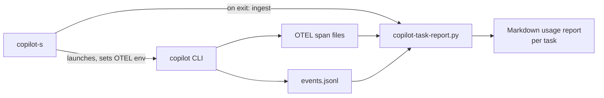

# copilot-cli-toolkit

Personal-workflow tooling for the [GitHub Copilot CLI](https://github.com/github/copilot-cli):
a session manager with automatic per-task usage/cost reporting, and a
7-role multi-agent implementation pipeline (discovery/planner → coder/
senior-coder → reviewer → tester → test-reviewer) with cost-aware, bounded
routing — all source/code changes (production source, tests including
tester-authored tests, scripts, Storybook stories, and executable or
behavior-affecting configuration) receive independent review;
discovery, planning, and testing remain conditional.

Both pieces are independent — use the session manager without the agent
pipeline, or vice versa.

## Why

The Copilot CLI is powerful but, out of the box, gives you no persistent
cross-directory session list, no automatic usage/cost accounting tied to
your actual task work, and no opinionated structure for multi-step
implementation tasks. This toolkit adds all three as a thin, inspectable
layer around the stock CLI — it never forks or patches `copilot` itself.

## Copilot Auto mode vs. this toolkit

Copilot's `/model auto` setting and this toolkit solve different problems.
Auto mode lets Copilot dynamically choose a model for the current work.
This toolkit adds workflow policy *around* Copilot: session management,
task-level reporting, custom roles, explicit model defaults, bounded loops,
and conditional stage routing with mandatory independent review for
source/code changes, including tests and behavior-affecting configuration
even when they add no executable behavior. Pure prose/documentation and
mechanical git-only operations are normally exempt.

The toolkit is **not automatically better, smarter, or more reliable than
Auto mode**. Auto is maintained by GitHub and can adapt as models and routing
improve. The toolkit is useful when you prefer more control and repeatability,
and accept the maintenance and orchestration overhead that comes with it.

| Area | Copilot Auto mode | This toolkit |
|---|---|---|
| Model selection | Copilot chooses dynamically based on the current request | Each custom role has a visible default model, with personal overrides available through `/subagents` |
| Workflow | Flexible; Copilot decides whether and how to delegate | A documented task-tier policy decides which roles run; all source/code changes, including tests and behavior-affecting configuration, receive independent review |
| Cost control | Relies mainly on Copilot's automatic routing and account limits | Uses cheaper routine roles, tiered reviewer routing, conditional stages, and bounded review/test loops |
| Role separation | May handle planning, implementation, review, and testing in one session | Separates discovery, planning, production coding, review, and testing into narrowly-scoped roles |
| Repeatability | Routing may change as Auto evolves or as prompts differ | Agent files and instructions are inspectable, version-controlled defaults |
| Session management | Uses Copilot CLI's native session commands | Adds a global cross-directory session list, bulk deletion, naming, and exit-time keep/rename/delete prompts |
| Usage reporting | `/usage` reports session usage interactively | Creates cumulative per-task Markdown reports with models, tokens, time, effort attribution, and estimated cost |
| Maintenance | Lowest maintenance; GitHub updates the routing | You maintain agent prompts, model defaults, pricing data, and compatibility with future CLI changes |

### Which should you use?

- **Use Auto alone** when you want the simplest experience, trust GitHub's
  model routing, and do not need this toolkit's session/reporting features or
  explicit development stages.
- **Use the toolkit's agent defaults** when repeatable role boundaries,
  visible model choices, cost budgets, and review/test discipline matter more
  than fully automatic routing.
- **Use both together (recommended for most users):** keep the main Copilot
  session on Auto, while custom subagents use their role-specific defaults.
  Auto can handle normal conversation and orchestration; the toolkit supplies
  the session manager, task reports, and reusable role definitions.

### Reliability caveat

The agent pipeline is implemented with Copilot custom-agent profiles and
instructions, not a separate deterministic workflow engine. The model can
still decide that a stage is unnecessary or handle work in the main session.
The orchestrator instructions make behavior more consistent, but cannot
guarantee that every prompt follows an identical sequence.

For work that requires strict process enforcement, explicitly invoke the
desired agent (for example, `/agent reviewer`) and verify delegated work with
`/tasks`. For standard, complex, and high-risk work—and any task requiring
broad discovery or design planning at any tier—the orchestrator requests
approval of the proposed routing before substantive work. Routine small
implementation remains on its automatic coder route; simple questions stay
direct. When runtime autopilot is active, the orchestrator instead selects
the best-supported recommended in-scope route without asking for routing
approval, visibly announcing it before acting; other required permissions
still apply. This applies only
to active autopilot in sessions using the installed global instructions;
normal modes are unchanged. Future launches load those instructions; existing
sessions may need a reload or restart.

## Features

- **Global session manager** (`copilot-s`) — list, resume, rename, and
  delete Copilot CLI sessions across every directory, not just the one
  you're in, plus a recoverable cleanup of empty, never-used sessions.
- **Subagent model refresh** (`copilot-s` menu `p`) — compares each
  subagent route against the current official GitHub Copilot prices and the
  current official model capability pages (with a dated, sourced catalog
  as fallback), lists every model in view with its documented facts and
  whether you verified it, shows the current/proposed table with reasons
  plus optional (possibly more expensive) alternatives that have a
  documented differentiator, and applies local overrides only after you
  type `yes`; shipped defaults and your own `/subagents` values are never
  overwritten.
- **Automatic per-task usage reports** — every session exit appends
  token counts, model-call time, reasoning-effort intent, and an estimated
  USD cost to a cumulative Markdown report for the task associated with
  your current git branch (or a free-form task name/ID you provide).
- **Per-launch session reports and opt-in RTK mode** — every `copilot-s`
  launch gets a metadata-only run record (exact session link or `unknown`,
  exit status, wall clock, OTEL calls/tokens, a frozen estimated cost);
  `copilot-s --rtk` runs one launch with a session-local
  [RTK](https://github.com/rtk-ai/rtk) 1.2.0 hook for simple test/build
  commands, with isolated per-launch RTK statistics, so normal and RTK runs
  can be compared (observationally). See
  [Per-launch session reports and RTK mode](#per-launch-session-reports-and-rtk-mode---rtk).
- **7-role agent pipeline** — `discovery`, `planner`, `coder`,
  `senior-coder`, `reviewer`, `tester`, `test-reviewer`, wired together by
  an orchestrator with explicit task tiers; all source/code changes,
  including tests, scripts, stories, and behavior-affecting configuration,
  get independent bounded review while discovery, planning, and testing
  remain conditional to avoid duplicated, token-burning work.
- **Official GitHub per-token pricing, refreshed automatically** — the
  estimated USD cost uses GitHub's published
  [Copilot models and pricing](https://docs.github.com/en/copilot/reference/copilot-billing/models-and-pricing)
  rates (input / cached input / cache write / output, Default and
  Long-context tiers), fetched from docs.github.com, strictly validated and
  cached for 24h. Each call is priced at ingestion and recorded with the
  snapshot that priced it, so later rate changes never reprice the past.
  Unlisted models or unpriceable usage are reported as partial coverage,
  never silently as $0.
- **Symlink-based install** — the repo is the source of truth; `git pull`
  (or `scripts/update.sh`) updates your live tools immediately, no
  re-install step required.

## Architecture



See [`docs/architecture.md`](docs/architecture.md) for the full breakdown,
including the multi-agent pipeline diagram and ingest/idempotency design.

## Example report output

```markdown
# Copilot Task Usage Report — ABC-123

- Report last updated: 2026-09-20T14:03:11Z
- First recorded: 2026-09-18T09:12:45Z
- Copilot sessions contributing: 3

## Summary

| Metric | Value |
|---|---|
| Model calls | 42 |
| Prompt (input) tokens | 186,204 |
| ...of which cache-read tokens | 61,880 |
| Completion (output) tokens | 24,517 |
| Total tokens | 210,721 |
| Model-call time | 18m 32s |
| Estimated USD cost (official GitHub per-token rates recorded at ingestion — estimate, NOT a bill) | $0.41 — **PARTIAL (lower bound)**: 40 of 42 calls priced; excludes 2 unpriced |
| Official rate source | GitHub Copilot models and pricing — cache fresh (3.2h old, snapshot `sha256:…` fetched 2026-09-20T10:51:02Z) |

## Estimated Cost Coverage (official GitHub Copilot per-token rates)

| Model | Calls | Priced calls | Est. USD (official rates) | Unpriced calls | Legacy calls | Official model / tiers used |
|---|---|---|---|---|---|---|
| claude-sonnet-5 | 30 | 30 | $0.36 | 0 | 0 | claude-sonnet-5 (Default×30) |
| gpt-5.4-mini | 10 | 10 | $0.05 | 0 | 0 | gpt-5.4-mini (Default×10) |
| some-unlisted-model | 2 | 0 | not priced | 2 | 0 | — |

- 2 call(s) not priced: model not listed in the official GitHub pricing snapshot used at ingestion
```

(Illustrative — no real task IDs, tokens, or costs; generated from
synthetic data for documentation purposes.)

## Requirements

- macOS or Linux with Bash ≥ 3.2 (the default macOS `/bin/bash` works; no
  Bash 4+ features are used).
- Python 3.7+ (stdlib only — no dependencies to install).
- [GitHub Copilot CLI](https://github.com/github/copilot-cli) (`copilot`)
  installed and on `PATH`.
- `git` (for task-key-from-branch detection, and for `scripts/update.sh`).
- Optional, only for `copilot-s --rtk`: [RTK](https://github.com/rtk-ai/rtk)
  **1.2.0** on `PATH` (other versions are refused).

## Quick install

```bash
git clone https://github.com/<you>/copilot-cli-toolkit.git ~/copilot-cli-toolkit
cd ~/copilot-cli-toolkit
scripts/install.sh --dry-run   # preview what will change
scripts/install.sh              # symlink executables, agents, and instructions into place
```

This installs:

| What | Installed to | Method |
|---|---|---|
| `copilot-s`, `copilot-task-report.py`, `copilot-session-cleanup.py`, `copilot-report-cleanup.py`, `copilot-model-refresh.py`, `copilot-session-report.py` | `~/.local/bin/` | symlink by default (or plain file copy with `--copy`) |
| Session-local RTK hook plugin (`copilot-s --rtk` only) | `~/.local/bin/copilot-s-rtk-plugin/` | symlink (or copy with `--copy`), file by file; loaded per launch with `--plugin-dir`, **never** installed as a Copilot plugin |
| 7 agent definitions | `~/.copilot/agents/` | symlink (or copy with `--copy`) |
| Orchestrator instructions | `~/.copilot/copilot-instructions.md` | symlink (or copy with `--copy`) |
| Legacy pricing table (inactive) | `~/.copilot/task-reports/model-pricing.json` | **copied once, only if absent** — your edits are never overwritten; no longer used by the report |
| Legacy company request-pricing policy (inactive) | `~/.copilot/task-reports/request-pricing.json` | **copied once, only if absent** — your edits are never overwritten; no longer used by the report |
| Official pricing cache | `~/.copilot/task-reports/official-pricing-cache.json` | **created automatically at runtime** (not by the installer) from docs.github.com; refreshed when older than 24h |

Make sure `~/.local/bin` is on your `PATH`. Any pre-existing file at an
install destination is backed up (never deleted) before being replaced —
see `scripts/install.sh --help`.

> **Symlink mode and your checkout are linked.** By default every installed
> file (except the copied pricing configs) is a symlink pointing back into *this*
> repo checkout. That's what makes `git pull` / `scripts/update.sh`
> instantly update the live tools — but it also means **moving or deleting
> this checkout breaks the installed commands** (`copilot-s` will fail with
> a "No such file or directory" style error, since the symlink now points
> nowhere). If you need to relocate the checkout, either re-run
> `scripts/install.sh` from the new location (it will re-link everything in
> place), or install with `--copy` up front if you'd rather have
> self-contained copies that don't depend on the checkout's location at all
> (at the cost of no longer auto-updating on `git pull`).

## Usage

```bash
copilot-s                     # list sessions relevant to the current directory
copilot-s --all               # list every session, across all directories
copilot-s --report ABC-123    # print/regenerate the cumulative usage report for a task
copilot-s --task ABC-123      # alias for --report (kept for convenience; --report is
                               # the canonical/documented flag name for this toolkit)
copilot-s --help               # show usage/features and exit (safe: never launches copilot)
copilot-s --version | -v       # print the copilot-s version and exit (safe: never launches copilot)
copilot-s --rtk                # this one launch in RTK mode (opt-in, never remembered)
copilot-s --session-report ID  # read-only per-launch report for a session (never launches copilot)
```

From the session list you can resume, rename, or delete sessions
(single/range/multi-select). On exiting a `copilot` session you'll be
prompted to keep, rename, or delete it.

New sessions prompt for a name and pass it to Copilot's native `--name`
option, so it applies during the session, not just after exit. Blank input
keeps automatic naming; prompted names are trimmed and pipes become spaces
in both the launched native name and the wrapper's index. Caller
`--name`/`-n` or session-selection options skip this prompt. This requires a
Copilot CLI version supporting `--name`
(verified with 1.0.109). Exit-menu renaming remains a wrapper index alias.
Wrapper options are recognized only before `--` and outside known native
value operands. The `--` marker and everything after it pass through
unchanged; enforced model options and any prompted name go before it.

### Cleaning up empty sessions (recoverable)

Menu option `c) Clean up empty sessions (recoverable)` previews, then — only
after you type exactly `yes` (anything else, Enter, or EOF cancels) — moves
empty sessions into a private quarantine batch,
`~/.copilot-s-quarantine/<batch>/sessions/<id>/`. Nothing is deleted or
copied: each directory is moved with an atomic no-replace rename on the same
filesystem (a different filesystem, or a system without macOS
`renameatx_np`/Linux `renameat2`, is refused), and `manifest.json` in the
batch records every step, including the session-list rows before they are
removed.

- **Scope:** the current directory's exact cwd, or every directory when the
  list is showing all sessions (`--all`/`a`).
- **Eligible only if all hold:** the directory is an exact UUID and contains
  only a regular `workspace.yaml` — alone, or together with the complete,
  untouched empty scaffold some Copilot CLI versions create for a never-used
  session: an empty `.workspace-fork.lock`, empty `files/` and `research/`
  directories, and `checkpoints/` holding only an `index.md` that is exactly
  the empty "Checkpoint History" table header. A partial scaffold, any
  symlink or hard-linked file, foreign owner, extra entry, non-empty lock,
  checkpoint row, or any `events.jsonl`/`session.db`/other file (even
  empty) excludes it. The metadata is plain scalars with
  `user_named: false`, no native name/summary, and `updated_at` within 1s of
  `created_at`; it was created, and it and every scaffold item last
  modified on disk, more than 24h ago; it has no custom name in
  `~/.copilot-sessions`; its ID is not in the current environment; and
  `lsof` (macOS/Linux) positively reports that neither the directory nor
  any of its files/directories (including the lock) is open. If any check
  is unavailable or fails, the session is kept.
- **Recent empty sessions (opt-in, default No):** before the preview, menu
  `c` asks `Also include recent empty sessions (created or changed within
  the last 24h)? [y/N]`. Only `y`/`yes` opts in; Enter or anything else
  keeps the 24h minimum age. Opting in removes **only** the minimum age:
  timestamps must still be valid, `updated_at` within 1s of `created_at`,
  and no timestamp may be in the future; every other check above is
  unchanged. The helper equivalent is `--include-recent`, which must be
  passed to both `preview` and `apply` (`apply` refuses the whole request if
  the previewed candidates were produced with a different choice). A recent
  empty session may have been created moments ago — by a Copilot that is
  still starting, or by something else; its origin is not known — and could
  start being used right after the open-file check. That race is accepted
  because the session is only moved to quarantine and can be restored; the
  separate exact `yes` confirmation is still required.
- The preview lists each candidate with counts of kept sessions by reason.
  Before each move the session is re-validated and compared with the
  preview fingerprint (which covers `workspace.yaml` and every scaffold
  item); changed sessions are skipped, a session that changes during the
  move is moved back, and nothing beyond the preview is ever moved. Only moved IDs are removed from `~/.copilot-sessions`.
- `copilot-s` and the cleanup share a lock on `~/.copilot-sessions.lock`;
  while another process holds it, the session list is left unchanged (and a
  delete is cancelled) rather than rewritten without the lock.

Restore a batch (asks for `yes`; refuses ID collisions and changed
quarantined contents; re-adds a recorded session-list row only if missing;
moves under the session-list lock; refuses any batch whose permanent purge
was started):

```bash
copilot-session-cleanup.py list
copilot-session-cleanup.py restore --batch 20261113-184600-1a2b3c4d
```

Limitations: Copilot's own session history/index (for example
`session-store.db`) is never read or modified, so native history views may
still list quarantined sessions; the activity check narrows but cannot
eliminate a race with a Copilot process starting at the same moment.
Quarantine is never purged automatically — purge a batch explicitly (menu
`x`, see [Permanently purging a quarantine batch](#permanently-purging-a-quarantine-batch-menu-x-and-r--4-irreversible))
once you are sure you do not need it.

### Cleaning run reports and private RTK data (menu `r`, recoverable)

Menu option `r) Clean run reports and private RTK data (recoverable)` — in
the session list **and** in the "No saved sessions found" menu, so old
reports can be managed even without saved sessions — opens a small submenu:

1. **Preview, then quarantine.** First asks `Also include run reports
   finalized within the last 24h? [y/N]` (default No), then runs the
   read-only `copilot-report-cleanup.py preview`. Only after you type
   exactly `yes` are the **exact previewed** runs (run id + fingerprint, same
   recent-runs choice) passed to `apply`.
2. **List quarantine batches** (read-only).
3. **Restore a quarantine batch:** pick a batch, read the read-only restore
   plan, type exactly `yes`.
4. **Permanently purge ONE quarantine batch** (frees disk space;
   IRREVERSIBLE) — see
   [Permanently purging a quarantine batch](#permanently-purging-a-quarantine-batch-menu-x-and-r--4-irreversible).
   Listed in the submenu but deliberately not in its short `Choose [...]`
   prompt.

Enter/`b` returns to the session menu. Cancelling, a helper failure or a
success always returns to the menu — Copilot is never launched from here.
The helper is found next to `copilot-s` (falling back to
`~/.local/bin/copilot-report-cleanup.py`); override it with
`COPILOT_REPORT_CLEANUP_HELPER`.

- **Scope — all workspaces:** every per-launch run report under
  `~/.copilot/session-reports/runs/<run-id>/` (run records do not store the
  working directory, so there is no current-directory filter), each moved as
  a whole folder: `run.json`, the hook log and the private `raw/` folder
  (Copilot's usage file; for RTK launches RTK's own history DB, tee/recall
  stores, config and preflight folders) — plus, for RTK launches, the run's
  own publication `~/.copilot/copilot-s-rtk-export/v1/runs/<run-id>.json`.
- **Never touched:** the global RTK database/config, Copilot's
  session-state, logs and OTEL files (paths recorded inside `run.json` are
  never used), publications without a run report, and reports under a
  custom `COPILOT_SESSION_REPORTS_DIR` (preview/apply refuse to run while it
  points elsewhere than the default root). Each launch is handled on its
  own; other launches and resumes of the same session are never touched.
- **Eligible only if all hold (fail closed):** a finalized launch —
  `completed`, `copilot-error` or `interrupted` — whose record has schema
  `copilot-s.session-run` with integer `schema_version` 1, the folder's run
  id, a known mode/launch kind, a state/outcome/state-reason consistent
  with an integer exit code, and valid, ordered `created_at` ≤
  `launched_at` ≤ `ended_at` ≤ `finalized_at`; finalized **and** every file
  last changed more than 24h ago (the opt-in only waives this minimum age;
  nothing may be in the future); plain private files and folders only (no
  symlink, hard link, FIFO/socket/device, foreign owner, group/world-writable
  entry or other filesystem; bounded size and depth); an RTK publication, if
  present, is a private regular file of schema `copilot-s.rtk-launch` v1 for
  the same RTK run; the run id is not in the current environment; and a
  system `lsof` (macOS/Linux) positively reports that nothing has the run
  folder, any file/folder inside it, or its publication open. Incomplete
  (active), `report-failure`, RTK-preflight-failed, unknown or malformed
  runs are **always** kept, whatever their age. The preview shows kept runs
  counted by reason; at most 100 runs per batch.
- **Moves, never deletes:** after re-validating each run under its locks
  (fingerprint must still match the preview), its publication and then its
  run folder are moved with an atomic no-replace rename on the same
  filesystem into `~/.copilot/copilot-s-report-quarantine/<batch>/`
  (`runs/`, `publications/`, `manifest.json`; `0700`). The manifest records
  every step durably, so a crash part-way is recoverable with `restore`.
  **No disk space is freed** by the quarantine — the data stays on disk until
  you purge that batch explicitly (submenu `4`); nothing is ever purged
  automatically.
- **Coordination with the report producer:** cleanup and restore take the
  quarantine's own transaction lock, then the RTK publication
  reconciliation lock, each run's own lock and the global publication
  capacity lock (in that order), so `finish`, the live publisher and
  start-up reconciliation can never write into a moved run folder or
  republish a moved run. Preview and list create no files, folders or locks.
- **Moved launches disappear from reports** (`copilot-s --session-report`,
  `compare`) and from viewers of the publication until restored.

Command-line equivalent:

```bash
copilot-report-cleanup.py preview [--include-recent]        # read-only
copilot-report-cleanup.py list                              # read-only
copilot-report-cleanup.py restore --batch <batch>           # read-only plan
copilot-report-cleanup.py restore --batch <batch> --yes     # restore
```

`apply` reads the preview's `CANDIDATE` lines on stdin exactly as printed
(`CANDIDATE<TAB><run-id><TAB><fingerprint>[<TAB>include-recent]`; no other
format is accepted — the menu forwards them unmodified). Restore never overwrites or merges: it refuses a run whose id (or
publication) already exists at the original place and any quarantined data
whose fingerprint changed; a publication is restored only after its run
folder and only while the publication folder is below its 256-file cap.

### Permanently purging a quarantine batch (menu `x` and `r` → `4`, irreversible)

Quarantine (menus `c` and `r`) never frees disk space. To release it, purge
**one** quarantine batch at a time, explicitly:

- **Quarantined empty sessions:** menu `x) Permanently purge a
  quarantined-session batch (irreversible)` — in the session list and in the
  "No saved sessions found" menu (listed there but not in the short prompt).
- **Quarantined run reports and private RTK data:** submenu `r` → `4`.

Each lists the batches with their purge status (read-only `purge-list`),
lets you pick one by number (Enter cancels), then runs the helper's
interactive `purge`, which first prints the **exact inventory** (each
session / run report with its file and folder counts and allocated size,
plus the batch's own manifest and folders), the total, the **estimated
reclaimable space** and a snapshot id. It deletes only after you type, on
the terminal, exactly the phrase it shows:

```text
PURGE sessions 20261113-184600-1a2b3c4d 3f9a1c2b7e4d      # or: PURGE reports ...
```

Anything else, Enter alone, or no answer within 120 seconds cancels;
typed-ahead input is discarded; there is no `yes`/`--force` bypass and
`purge` refuses to run without a real terminal. No lock is held while it
waits for you. Afterwards it takes the quarantine's existing lock, rebuilds
the whole plan and deletes only if the snapshot is **identical** to the one
you confirmed.

- **Eligible batches only (fail closed):** no purge was ever started for the
  batch; its manifest is valid and **fully settled** — every entry `moved`
  or `skipped`, at least one `moved` (batches still being applied or
  restored, partly restored, `failed`, `pending` or with an unfinished
  session-list update are refused); every moved session / run folder /
  publication is present and still matches the fingerprint recorded when it
  was quarantined (the same checks `restore` uses), skipped entries left
  nothing in the batch, and nothing else is in it; every file and folder is
  plain, yours, single-link, not group/world-writable, without
  setuid/setgid/sticky bits or immutable/append-only flags, on the batch's
  own mount (macOS: `fstatfs` mount identity; Linux: `mnt_id` plus no mount
  point at or inside the batch in `/proc/self/mountinfo` — bind mounts
  included), within 20,000 entries and 24 levels; and a system `lsof`
  positively reports that nothing has any of it open. Unknown is refused.
- **Estimate, not a promise:** the reclaimable space is the sum of every
  entry's allocated blocks (`st_blocks` × 512). APFS clones and snapshots
  (including Time Machine local snapshots), files still open elsewhere,
  compression and filesystem metadata can make the real figure differ.
  Deletion is **not** secure erasure.
- **How it deletes:** before the first deletion it durably writes a compact
  journal `<quarantine>/.purge/<batch>.json` (`started`), then removes only
  the inventoried entries, bottom-up, each relative to its parent folder's
  descriptor after re-checking (without following symlinks) that the entry
  and every parent folder are still exactly the confirmed ones: payload
  first, then the manifest, then the batch folder. It never lists new
  targets, never changes permissions and never uses a recursive delete.
  The journal then says `complete` and is kept.
- **Partial purges:** the first discrepancy, I/O error, time limit (5 min)
  or Ctrl-C stops it; the journal says `partial` (or stays `started` after a
  crash) and the output reports what is left. A batch with any journal can
  no longer be restored and is never purged or retried automatically —
  `list`/`purge-list` mark it; review what is left yourself.
- **Locks:** sessions use the existing session-list lock
  (`~/.copilot-sessions.lock`), which `restore` now also holds while moving;
  run reports use the quarantine's `.transaction.lock`, which `apply` and
  `restore` hold for their whole run. A purge never opens or creates
  anything at the live session or report locations.
- **Limitations:** macOS and Linux only; a hostile process running as you
  that swaps a file between the final check and the unlink cannot be ruled
  out portably (the copilot-s tools are excluded by the locks, everything
  else must be quiescent, checked with `lsof`); Linux `chattr +i` and ACLs
  denying deletion are not inspected and would stop the purge part-way.

Command-line equivalents (path options for the session helper go before
the subcommand, as for its other commands):

```bash
copilot-session-cleanup.py purge-list                      # read-only
copilot-session-cleanup.py purge-preview --batch <batch>   # read-only
copilot-session-cleanup.py purge --batch <batch> [--snapshot <digest>]
copilot-report-cleanup.py  purge-list | purge-preview --batch <batch> | purge --batch <batch>
```

`purge-preview` prints `PURGE_SNAPSHOT<TAB><kind><TAB><batch><TAB><digest>`
(or `PURGE_INELIGIBLE<TAB><batch>`, exit 1); passing that digest to
`purge --snapshot` makes it refuse unless the batch is still exactly what you
previewed. `purge-list` prints one `PURGEABLE<TAB><batch>` line per
candidate. Exit status of `purge`: 0 purged or cancelled, 1 refused, error
or partial, 130 interrupted.

### Refreshing subagent models from current prices (menu `p`)

Menu option `p) Refresh subagent models from current prices` (also offered
when there are no saved sessions — there, Enter still starts a new session
and `p` returns to that menu instead of launching anything) runs
`copilot-model-refresh.py propose`:

1. **Current prices.** It fetches the official
   [models and pricing](https://docs.github.com/en/copilot/reference/copilot-billing/models-and-pricing)
   page now, through the same fixed-URL HTTPS fetcher, strict parser,
   validation, and cache as the usage reports (an explicit refresh skips
   the 24h TTL and the 1h failure backoff; a snapshot fetched under 5 min ago
   is reused). On failure (offline, parse error) the last valid snapshot is
   shown, but nothing is proposed unless it is under 24h old.
2. **Current capabilities.** In the same run it fetches the official
   [supported models](https://docs.github.com/en/copilot/reference/ai-models/supported-models)
   page (model list, 1M-context / configurable-reasoning table, per-client
   table incl. Copilot CLI) and the
   [model comparison](https://docs.github.com/en/copilot/reference/ai-models/model-comparison)
   ("Recommended models by task": task area, "Excels at"). Only those two
   fixed docs.github.com URLs are requested (HTTPS, certificate checks on,
   redirects refused, size/time bounded, no cookies or credentials; a
   verified system-curl fallback only after a Python certificate error).
   A strict, versioned parser turns them into a dated evidence snapshot
   (`~/.copilot/model-refresh/capability-evidence.json`, with URL, fetch
   time, content digest and parser version), reused for 5 min and usable
   for 3 days (supported models) / 7 days (comparison). A changed page
   layout, a missing column, conflicting rows or an unknown cell value
   becomes **unknown** with a warning — never a guess — and a failed fetch
   shows the last valid copy with its age; stale or unknown evidence never
   authorizes a change. Per model and field, fresh official evidence is
   used first and the dated catalog is the fallback. Disable the fetch with
   `COPILOT_MODEL_REFRESH_DOCS_FETCH=0` (or `--offline`).
3. **Table.** For each of the ten routes — the seven custom agents,
   `coder (small/casual)`, `reviewer (stronger override)`, and the built-in
   `task` route — it shows the current model · effort · context and its
   source (shipped default / managed override / your pin), the proposal,
   official input / cached / cache-write / output rates per 1M tokens
   (plus long-context tier rates), the snapshot id and cache age, and the
   reason and evidence for every keep/change decision. **All models in
   view** — the union of the official pricing, the official capability
   pages, the catalog, your verified records and the current routes,
   including unpriced or undocumented ones as *unknown* — are listed with
   price, task area, 1M context, configurable reasoning, Copilot CLI
   support, where each fact comes from, and your availability (verified /
   not verified / not in your complete `/model` list). This is not your
   account's model list: Copilot CLI documents no programmatic per-account
   listing, so availability is only what you verified. A model missing from
   the static catalog (for example GPT-6.2 Sol when the official pages list
   it) is assessed from the current official pages when they document its
   task area, Category, capabilities and CLI support; otherwise it is
   listed as unassessed and never assigned. Models new since your last
   refresh are flagged.
4. **Optional: record what you verified (`v`).** When replacements are
   blocked only by availability or reasoning levels you have not verified,
   `copilot-s` offers `v` (Enter skips). You type the model IDs you can
   select in Copilot CLI's `/model` picker, whether that is the complete
   list, and — only for models your routes need — the reasoning levels the
   picker shows for each. Nothing is saved unless you type `yes`; it goes to
   `~/.copilot/model-refresh/verified-models.json` (dated, valid 30 days;
   `user-config.json` is never written), and the proposal is re-evaluated
   once. Levels you do not re-enter keep their original date (never
   silently renewed).
5. **Optional alternatives.** Besides the cost-saving proposals (rule
   unchanged: at least 10% cheaper), a route can list numbered optional
   alternatives: models that pass every gate below, are in the route's
   official task area, are *not* at least 10% cheaper (they may cost the
   same or more), and have a concrete documented differentiator versus the
   current model — e.g. listed as included for Copilot CLI in the official
   per-client table when the current model is not listed there. A higher
   Category, a newer version or a higher price is never a differentiator;
   such models are shown as "considered" with the reason. Each alternative
   shows the blended price change in $ and % (and above the long-context
   threshold), the differentiator and its source, the official "Excels at"
   text labelled as the vendor's description, and its limits — no measured,
   equal or better quality claim. None is pre-selected: you may type their
   numbers (Enter = none); a selected alternative replaces that route's
   cost-saving change and still needs the final `yes`. Pinned routes and
   routes with an unknown current price get none.
6. **Confirm.** Changes are applied only after you type exactly `yes`
   (anything else, Enter, or EOF cancels). The proposal is frozen with
   digests of everything it read plus an evidence digest; `apply` (and
   `select`) re-derive every decision from the cached evidence and refuse,
   changing nothing, if `settings.json`, the refresh state, your user
   config or verified record, the routing defaults, the catalog, the
   capability evidence (or its freshness), the pricing snapshot or the
   generated files changed in between (the digests cover the parsed prices
   and capability values themselves), if the proposal is older than
   15 min (measured from its real creation; a future-dated or extended
   proposal is refused), was altered (proposals are sealed with a private
   key in `~/.copilot/model-refresh/.proposal-key`), was made by an older
   version, or was already applied. Every outcome — applied, cancelled,
   no changes, failed — prints the final effective routing (after a failure
   via `status`; if even that cannot read its inputs, an explicit
   "unavailable" message instead of a guessed table) and waits for Enter
   before returning to the menu.

**How a replacement is chosen (categorical fit, not a quality score).**
The facts are the official pricing page's *Category* (Lightweight /
Versatile / Powerful), the model comparison's *Task area*, the
supported-models page's 1M-context and configurable-reasoning support, and
its per-client Copilot CLI column — read live as above, with
`config/model-role-catalog.json` (a small, dated registry transcribed from
the same pages; reviewed 2026-11-16, expires 2027-02-14) as the fallback
when a page is unavailable or stale. A live value that differs from the
shipped catalog is shown as a change; one that contradicts your local
overlay blocks that model until you re-vet it. The shipped routes stay the
baseline. A route is changed only when it is not pinned and a candidate:

- has the same official task area as the route's shipped baseline model and
  a Category at least as high, configurable reasoning, 1M-context support if
  the route uses `long_context`, and is listed as included for Copilot CLI;
- when any of its facts come from the catalog: still shows the catalogued
  Category in the live pricing (otherwise it needs re-review) and the
  catalog entry has not expired;
- is in **your verified availability list** (`user-config.json` and/or
  the list recorded with `v`) — Copilot CLI documents no programmatic model
  catalog, so availability under your plan and organization policy is
  never assumed from the pricing or supported-models pages;
- has the route's **specific reasoning level** (e.g. `high`, `xhigh`)
  verified for that model — either a source-backed `reasoning_levels` entry
  in the catalog or your own dated record (`verified_capabilities` or
  levels recorded with `v`). The
  official docs only say reasoning is "configurable" and that levels vary
  per model (Copilot CLI shows them only in the interactive `/model`
  picker), so the shipped catalog lists no levels and an unknown level
  always blocks the replacement; and
- is at least 10% cheaper under a disclosed blended workload assumption
  (15% input, 75% cached input, 5% cache write, 5% output of the Default-
  tier rates — and, for `long_context` routes, also of the rates billed above
  the long-context threshold). A current model that is unpriced (shipped
  default or override alike) is always kept: no saving can be shown.

The effort and context tier stay those of the route baseline. Nothing is
inferred from price or release date; unknown, unavailable, unverified,
stale, or unpriced always means *keep* with the reason shown — including
for an existing managed override whose evidence can no longer be
re-verified (it is kept, never silently reverted; returning to the shipped
default is a change that must pass the same availability, reasoning-level
and catalog gates; `reset` returns it unconditionally). All dates you or a
catalog enter (`reviewed_on`, `retrieved_on`, `expires_on`, `verified_on`)
are compared with your **local** calendar date. A catalog (shipped or local) whose review or any source
`retrieved_on` date lies in the future, whose sources postdate its review,
or whose `expires_on` is not after `reviewed_on` cannot authorize any
replacement. The table
itself states, before the routes, that fit is categorical and **not**
measured quality, and a proposed change never claims equal quality. When
replacements are blocked only by availability or reasoning levels you have
not verified (always the case on a first run), the output ends with an
**ACTION REQUIRED** block naming the blocked candidates and a ready-to-edit
`user-config.json` example.

**Your user config** — `~/.copilot/model-refresh/user-config.json` (never
written by the tool; all keys optional):

```json
{
  "schema_version": 1,
  "available_models": {"verified_on": "2026-11-16", "models": ["gpt-6.1-terra", "claude-sonnet-5.5"]},
  "verified_capabilities": {"verified_on": "2026-11-16", "models": {"gpt-6.1-terra": {"reasoning_levels": ["low", "medium", "high"]}}},
  "pins": {"reviewer.stronger": {"model": "claude-opus-5.5"}},
  "catalog": {
    "reviewed_on": "2026-11-16", "expires_on": "2027-02-14",
    "sources": {"my-review": {"url": "https://example.com/my-review", "retrieved_on": "2026-11-16"}},
    "routes": {"coder": {"accepted_task_areas": ["Complex coding tasks", "Interactive and agentic coding"]}},
    "models": {}
  }
}
```

`available_models` older than 30 days blocks replacements until you re-verify
it. `verified_capabilities` (same 30-day limit) records, per model, only the
reasoning levels you have seen offered for it in Copilot CLI's `/model`
picker — the example values above are illustrative, not verified facts.
`pins` (route keys: the agent names plus `coder.small_casual`,
`reviewer.stronger`, `task`) hold any of `model` / `reasoning_effort` /
`context_tier`. `catalog` is an optional dated local overlay with the same
schema as `config/model-role-catalog.json` (its model entries and route
policies take precedence) — this is how you vet a new model.

**What applying writes (and never writes).** Shipped defaults —
`config/agent-routing.yaml`, `agents/*.agent.md`, and the instructions — are
never edited, and the `copilot` launch still forces Auto with the Balance
tier for the main session. Effective routing is resolved as shipped defaults
→ managed overrides → your pins (native `/subagents` values in
`~/.copilot/settings.json` that this tool did not write, then `pins` in the
user config). One journaled transaction (backups under
`~/.copilot/model-refresh/backups/`, rolled back on failure, recovered on
the next run after a crash, Ctrl-C deferred while it commits) updates:

- `~/.copilot/settings.json` → `subagents.agents.<agent>.{model,
  effortLevel, contextTier}` for agent default routes with a managed
  override or a `user-config.json` pin (each field gets the effective value,
  so a tool-written value never contradicts a later user-config pin). Values
  you set yourself in `/subagents` are never overwritten, and values the
  tool wrote earlier are removed again when no longer needed. Other
  settings are preserved, but the file is re-serialized as 2-space JSON; a
  non-JSON or symlinked `settings.json` is never written.
- `~/.copilot/instructions/copilot-toolkit-model-routing.instructions.md` —
  a generated personal instruction holding only the effective table
  (validated model IDs, efforts, tiers, `OMIT`; no prices or remote text).
  It exists only while a managed override or a user-config pin exists —
  native `/subagents` values alone never create it, and `reset` removes it
  when only those remain. A field you set in `/subagents` is written as
  `OMIT`, never as a frozen copy of its value. A symlinked `instructions/`
  directory, or a file there that the tool did not write, is never written
  through or replaced.
- `~/.copilot/model-refresh/state.json` and `effective-routing.json` (same
  lifetime as the generated instruction; `/subagents` fields are `null`).

**How the orchestrator uses it.** The shipped orchestrator instructions
tell it to run `copilot-model-refresh.py status --instructions` before each
delegation to a toolkit route. That command is local and read-only (no
network, pricing, or catalog) and reads `settings.json` live, so a
`/subagents` change is honored on the next delegation without running `p`:

```
discovery            model=gpt-6-luna reasoning_effort=low context_tier=long_context
coder                model=OMIT reasoning_effort=medium context_tier=default
```

`OMIT` means the field is left out of the task call so your live
`/subagents` value applies (the task tool has no `inherit` value). If the
command is unavailable or reports the routing unavailable (for example an
unreadable `settings.json` or a pending interrupted apply), the generated
table — same `OMIT` rule — or else the shipped defaults apply.

**Limits.** Copilot CLI 1.0.112 documents the per-agent `subagents.agents`
settings but not their precedence over explicit task-tool parameters, and
one per-agent value cannot express the small/casual coder or stronger
reviewer contexts. Omitting a field is the only way to leave a native value
in effect; the routing above is instruction guidance the orchestrator
follows, not a hard guarantee. New sessions load the generated instruction
(check with `copilot instruction list`). `settings.json` can also be
rewritten by Copilot itself; the tool re-checks its digest right before
replacing it, which narrows but cannot eliminate that race.
`copilot-model-refresh.py status` shows the effective routing without any
network or writes (and reports it as unavailable rather than guessing when
`settings.json` cannot be read); `copilot-model-refresh.py reset --yes`
removes every managed override and only the `/subagents` values the tool
wrote (your pins stay). An interrupted apply is rolled back on the next run
only when its journal is fully valid (known targets, backups inside the
tool's own backups folder that still match); otherwise nothing is restored
or deleted and the output explains how to recover by hand.

**Evidence limits, privacy.** The official pages say *whether* a model has
configurable reasoning, not which levels; which models and levels YOU can
use is visible only in Copilot CLI's interactive `/model` picker (no
documented programmatic listing), so availability and levels are never
claimed automatically — only from what you record. Fit is categorical: no
output claims measured, equal or better quality, and the blended price
impact is an assumption, not your bill. The capability fetch sends only a
plain GET for the two fixed public URLs (no credentials, cookies, model
usage or local data); remote text is sanitized, shown only in the
terminal, and never written into the generated instruction or settings.
Scripted use: `copilot-model-refresh.py propose` prints machine lines
`PROPOSAL<TAB>id`, `ALTERNATIVE<TAB>n<TAB>route<TAB>model` and
`VERIFY<TAB>needed`; `select --proposal-id ID --choose 1,2` adds chosen
alternatives (new id); `record-verified` is interactive and refuses to run
without a terminal.

### Context metrics (new copilot-s sessions only)

For sessions **created by `copilot-s` from this version on** (`n`, or the
automatic new session), `copilot-s` shows two numbers when the session
stops (before the keep/rename/delete prompt) and next to it in the session
list:

- **Context % last observed before compaction** — `currentTokens /
  tokenLimit` from the latest valid `session.compaction_start` event. It is
  the fill level at the most recent compaction trigger, **not** the live or
  at-exit usage (the shutdown event has no verified token limit, so the two
  are never combined). Values over 100% are shown as recorded. `N/A` means
  no valid pre-compaction snapshot has been recorded — either no compaction
  has started yet, or every compaction start had missing/invalid/out-of-range
  token fields (those are counted and reported, never guessed).
- **Successful compactions** — `session.compaction_complete` events with
  `success: true` only.

Enrollment is conservative: a new session is enrolled only if exactly one
new session directory (with this cwd, created after launch) appeared during
the run; otherwise a warning is printed and nothing is recorded. A session
whose `workspace.yaml` `created_at` is missing or unparseable cannot be
verified as created after launch and is likewise not enrolled (warning).
Existing, imported, or externally created sessions are never enrolled or
scanned.
Values are cached in `copilot-s-context.json` inside the session directory
(numbers and a read cursor only — no message text), refreshed when an
enrolled session is resumed and stopped; the list reads only that file. If
`events.jsonl` is missing/unreadable the count is shown as unknown, and
corrupt or truncated lines are reported (`>=N`, "log incomplete") rather
than hidden. No per-task summary is generated.

### Per-launch session reports and RTK mode (`--rtk`)

Every `copilot` launch made by `copilot-s` — new or resumed — gets one run
record with a fresh random run id, in one of two modes:

- **normal** (default, unchanged behavior): the baseline;
- **RTK** (`copilot-s --rtk`, opt-in **for that one launch**, never
  remembered): a session-local hook rewrites a small allowlist of simple
  test/build commands to [`rtk <command>`](https://github.com/rtk-ai/rtk)
  so their output is compacted before it reaches the model.

```bash
copilot-s --rtk                        # this launch in RTK mode (menu shows [RTK mode])
copilot-s --session-report SESSION_ID  # read-only: every copilot-s launch of a session, by mode
copilot-session-report.py launch --run-id RUN_ID [--format json]
copilot-session-report.py session --session-id SESSION_ID [--format json]
copilot-session-report.py compare [--format json]   # all runs grouped by mode
copilot-session-report.py mark-outcome --run-id RUN_ID --outcome completed|abandoned|unknown
```

**What a run record holds** (`~/.copilot/session-reports/runs/<run-id>/run.json`,
directories `0700`, files `0600`, atomic writes): mode, state
(`incomplete` until finalized, then `completed` / `copilot-error` /
`interrupted`, or `report-failure`), exit code, launch/end time and wall
clock (1 s resolution), the exact session link or `unknown` with a reason,
versions (copilot-s, Copilot from the session's own start event, RTK),
model calls/tokens and summed model-call time from the launch's **own** OTEL
file, an estimated cost, and in RTK mode the hook decision counts and RTK's
numeric aggregates. It never contains prompts, commands, arguments, tool
output or work file paths. `completed` only means Copilot exited with 0 —
whether the *task* was done is a separate, explicit `task_outcome`
(`unknown` until you run `mark-outcome`). Time-to-first-token is reported
as unknown (not captured). A token field the spans did not report (e.g.
reasoning or cache tokens) is `null` with per-field coverage, never a
measured 0; pricing keeps the task report's rule that an absent
cache/reasoning attribute costs nothing, while a missing input/output
count leaves the call unpriced and the usage `partial`.

**Exact session linking, never "the latest".** The resumed session, or the
single new session directory the existing strict detection found, is
cross-checked against the hook's own `session_id` (RTK mode) and the
conversation ids in the launch's OTEL file; with no launcher candidate, a
single conversation id in the launch's own OTEL file is used. Each launch
now writes a unique `~/.copilot/otel/copilot-otel-<timestamp>-<run-id>.jsonl`
(same `copilot-otel-*` pattern as before), so concurrent launches never
share a file. Any conflict or ambiguity leaves the session `unknown`.
Session reports group only exact run ids; earlier launches and launches
outside `copilot-s` are not covered and are never backfilled.

**Cost and savings are estimates.** Calls are priced once, at the end of
the launch, with the same validated official GitHub per-token snapshot the
task report uses (cache only, no network), frozen with its snapshot id and
fetch date, and never repriced. Unpriceable calls make the figure
`partial`, never $0. In RTK mode, the approximate value of the tokens RTK
avoided is RTK's own token estimate × the official input rate of this
run's priced calls — counted **once** as fresh input (cached or repeated
context is not accounted); several models give a min–max range, an
unknown rate gives `unknown`, and if some of the run's calls used a model
without a known rate the value is marked `partial` and names those models
(the range then covers only the priced models). If RTK made output *larger*, that growth is
shown, never turned into a saving. `$0.00` appears only for a true zero;
tiny positive values show as `<$0.01`. None of this is a bill or a credit
deduction, and normal-vs-RTK comparisons are observational (different
tasks and prompts), not causal.

Copilot's own end-of-session summary is also requested with
`--usage-output-file` into the run's private folder (only numeric fields
are read; it is shown separately and never added to the OTEL figures;
invalid values such as NaN, negative or overlong numbers are discarded and
listed, making it `partial`, or `unavailable` if nothing valid remains). If
you pass your own `--usage-output-file`, `copilot-s` leaves it alone and
records the native summary as unavailable.

#### RTK mode details

- **Exactly RTK 1.2.0** (official release; verified end to end with Copilot
  CLI 1.0.114). Other versions are refused rather than assumed compatible.
- **Refuses to launch** (nothing is started, and the offending paths are
  listed) if RTK user configuration could change results: `config.toml`,
  `filters.toml` or the trust store `trusted_filters.json` in RTK's user
  directories (`~/Library/Application Support/rtk` on macOS,
  `$XDG_CONFIG_HOME|~/.config` and `$XDG_DATA_HOME|~/.local/share` `/rtk`
  on Linux, `%APPDATA%`/`%LOCALAPPDATA%` `\rtk` on Windows), or any Copilot
  hook configuration that already runs `rtk hook` (project
  `.github/hooks/*.json`, `.github/copilot/settings*.json` and
  `.claude/settings*.json` of every directory the session may run in or
  add — both its path as given and its real path, and their git roots —
  `~/.copilot` settings and user hooks, and every file of every installed plugin — inline `plugin.json`
  hooks and custom hook paths included) — or any such candidate that cannot
  be verified (a symlink, which is never followed, a non-regular,
  unreadable or over-1 MiB file, a missing project directory, or an
  installed-plugins tree too large or too deep to scan).
  The session directories checked are the launch directory plus, for a
  menu resume or `--resume=ID`/`--session-id ID` of an existing session,
  its recorded directory, an explicit `-C DIR`, and every `--add-dir`
  (relative ones resolved against the `-C` target or launch directory of a
  new session). If copilot-s cannot tell where the session will run or
  what it adds (`--worktree`, `--connect`, `--continue`, `--resume` without
  an id, a resumed session with no readable recorded directory, or a
  relative `--add-dir` with a resumed/selected session), RTK mode refuses
  rather than guess, and a normal-mode run notes that it may not be an
  RTK-free baseline. Symlinked `.github`, `.github/copilot` or `.claude`
  directories in those roots are refused too (never followed). A project `.rtk/` folder
  is accepted: without a trust store its filters/pipelines are never
  loaded. Static checks run before the menu (for the launch directory);
  right before launch they run again for the session's actual directories,
  together with a smoke test of the real `rtk hook copilot`. `copilot-s`
  never edits RTK or Copilot configuration and never runs `rtk init`.
- **Isolation.** All inherited `RTK_*` variables are cleared for the launch;
  `RTK_DB_PATH`, `RTK_TEE_DIR`, `RTK_RECALL_DB` and `RTK_CONFIG_DIR` point
  into the run's private `raw/rtk/` folder (an empty pipeline directory, so
  no user pipelines or LLM delegation tasks), telemetry is disabled, no
  proxy is started and `HOME` is unchanged. Statistics come only from
  `rtk gain --format json` on that private database — never the global one
  and never a before/after diff.
- **Allowlist.** Only one plain command with plain arguments is eligible:
  `cargo test|build|check`, `go test|build`, `make test|check|build`,
  `mvn test|compile`, `dotnet build`, `playwright test`, `bun test`,
  `npm|pnpm run test|build`, `pytest`, `jest`, `tsc`, `ctest`, `phpunit`,
  `rspec`. Anything with pipes, `;`/`&&`, redirects, quotes, `$`, globs,
  environment assignments or a path as the program — and review or
  exact-output tools such as `git`, `diff`, `grep`, `cat` — runs unchanged.
  A rewrite is accepted only if RTK answers exactly `rtk <original command>`.
- **Permissions unchanged.** The hook never approves anything; Copilot
  checks the rewritten `rtk ...` command against your normal rules, so an
  allowlist like `shell(git:*)`/`shell(cargo:*)` may now prompt (or deny in
  `-p` mode). `copilot-s` deliberately does not add `shell(rtk:*)`, which
  would also allow `rtk run`/`rtk bypass`.
- **Fails closed.** If RTK disappears, errors, answers in an unexpected
  shape or asserts its own permission decision (allow or deny) during the
  session, an allowlisted command is **denied** with a clear message (never
  run unfiltered, never approved); exit and relaunch without `--rtk`.
- **Your own `--plugin-dir` plugins** are passed through unchanged and are
  never modified, but in RTK mode each one is inspected read-only first:
  the launch is refused if any file in it mentions `rtk hook`, or if it
  cannot be fully verified (missing, symlinked or non-regular entries,
  files over 1 MiB, unreadable or too large/deep trees, the copilot-s RTK
  plugin itself, or a relative path combined with `-C`, `--worktree` or a
  resumed/selected session — use an absolute path).
- **RTK's raw data stays private and is disclosed.** RTK's history
  database stores raw command lines and project paths, and tee/recall keep
  raw output; they live only in the run's `raw/` folder (with Copilot's
  usage file), are never copied into reports, and are **never deleted
  automatically** — remove old `~/.copilot/session-reports/runs/*` folders
  yourself when you no longer need them.
- If `copilot-s` itself is killed while Copilot runs, the record stays
  `incomplete` (no outcome is invented).

#### Automatic RTK publication for external viewers

`copilot-s --rtk` keeps RTK statistics in each launch's **private** database,
so tools that read RTK's default/global history (such as the optional global
RTK card in the [Agentic Watcher](https://github.com/a-wf/agentic-watcher)
macOS app) never see them. copilot-s therefore publishes a small numeric
file per RTK launch **automatically** — there is no export command to run.
The optional copilot-s per-launch card in Agentic Watcher reads these files
on its own (off by default in its Settings; once enabled it stays current).
This project is public at <https://github.com/a-wf/copilot-workbench>.

- **Location:** `~/.copilot/copilot-s-rtk-export/v1/runs/<run-id>.json`,
  one file per launch (parallel, resumed and multi-launch sessions each keep
  their own run id and file; nothing overwrites another launch). New
  folders are created `0700`, files are written `0600` atomically (temp
  file + `os.replace`) after exact-contract validation (at most 16 KiB per
  file). A symlinked, foreign-owned or group/world-writable `~/.copilot` or
  publication folder, or an existing publication that is not a private
  regular single-link file, is refused and never repaired. The `--rtk`
  launch itself is never affected by a publication failure. The retired
  manual `~/.copilot/copilot-s-rtk-export/v1.json` is ignored.
- **While a launch runs:** right before Copilot starts, copilot-s starts
  that launch's own background publisher (`copilot-session-report.py
  rtk-publisher`, internal — not a user command, never a daemon). It first
  publishes after ~2 s, then about **every 30 s**, runs at most one
  `rtk gain --format json` at a time (RTK calls never overlap) with the RTK
  binary recorded at launch (re-validated, never looked up on `PATH`:
  absolute real path, regular executable owned by you or root, not
  group/world-writable, no setuid/setgid, supported version), against that
  launch's private database only (inherited `RTK_*` variables removed),
  with a 15 s timeout and 1 MiB of stdout read incrementally. RTK may create
  or modify that private database. If RTK has recorded nothing yet the file
  says so (`none-recorded`); if a measurement fails, the previous file is
  left untouched — its `published_at` is not refreshed, so viewers see it
  age (Agentic Watcher stops counting it after 2 minutes) — and nothing
  fresher is invented. The publisher leads its own process group, ignores
  Ctrl-C meant for Copilot, checks every second that its parent is still
  this launcher (`getppid`, robust to PID reuse) and exits on SIGTERM/SIGHUP;
  a running `rtk gain` is cancelled and reaped. Right after Copilot exits —
  and always before the run is finalized — copilot-s stops it (SIGTERM to
  its group, up to 5 s, then SIGKILL) and reaps it, so no late active
  result can replace the final figures; each write is also re-checked under
  the run lock against the record's finalization.
- **When a launch finalizes:** `finish` publishes the statistics it stored
  at finalization (RTK is not run again) while still holding the run lock,
  replacing the active file. A failure there never changes the run record,
  report or exit status; it is retried by the next reconciliation.
- **Historical and missed launches (reconciliation):** every copilot-s
  launch with a session report (any mode) runs one bounded, resumable
  reconciliation slice before Copilot starts: at most 256 run folders probed
  (metadata only) in run-id order after a small persisted cursor
  (`v1/reconcile-cursor`, wrapping around), at most 32 records loaded, a
  ~1 s time budget (checked between runs), skipped when another slice holds
  its non-waiting lock. Finalized
  RTK-mode runs finalized within the last **14 days** are (re)published from
  their stored records when the publication is missing or older than the
  record/hook log (no RTK is ever run for this); backfill never evicts and
  adds new files only below 128. **Capacity:** at most 256 files; when a
  running launch's publisher or `finish` needs a new file at the cap, the
  oldest *finalized* publications (by `finalized_at`; only files that pass
  the full publication contract) are evicted from this sanitized cache to
  make room — run records and reports are untouched. Active publications
  are never evicted: if all 256 are active, the new write fails closed.
  All writes are serialized by a capacity lock (`v1/.capacity.lock`).
  Publications
  not rewritten for 14 days, whose record is no longer a publishable
  RTK-mode run, or (default reports root only) whose run folder was deleted
  are withdrawn; stale temp files older than 1 h are removed. Nothing is
  published for normal-mode or never-launched (failed preflight) runs, and
  folders are created only once an RTK-mode run exists.
- **Upgrading:** launches already running from an older copilot-s have no
  publisher; reopen or resume them through the updated launcher for live
  updates. Their final figures are published automatically once finalized
  (at the latest by reconciliation at a later launch).
- **Contents (numbers and labels only):** schema `copilot-s.rtk-launch`
  version 1, producer and helper version, `published_at` (last successful
  write), and for the launch: run id, mode `rtk`,
  `record_state` (`finalized` / `active-unfinalized`), launch kind, creation
  and finalization times, the session link and its proof, and RTK's
  availability (`available` / `none-recorded` / `unavailable`), measurement
  kind (`measured-while-active` / `stored-at-finalization`) and
  `measured_at` (distinct from `published_at`) plus, only when
  available, `total_commands`, `total_input`, `total_output`, `total_saved`
  (signed: may be negative when RTK made output larger), `total_time_ms`,
  `avg_time_ms`, `oversized_excluded` and `avg_savings_pct` (finite, may be
  negative, or `null`). Missing data is `unavailable`, never 0. Never
  included: commands, prompts, output, file or private-folder paths, error
  text, costs or billing data. Run records, reports and accounting are
  never changed.
- **Session link (publication only, stricter than the run record's link):**
  evaluated from this run's own explicit evidence only, and
  confirmed solely by: `launcher-selected-resume` — the launcher recorded a
  resume of exactly that session, and no session id in the run's own hook
  log and no conversation id in its own per-run OTEL file names another
  session — or `single-conversation-id-in-own-otel-file` — a new launch
  whose own OTEL file names exactly one conversation id, with every hook
  session id equal to it. Directory discovery (the run record's
  `unique-new-session-dir` basis), times, cwd and "the latest" never yield
  a link. While a run is **not finalized yet**, its publisher reads its own
  per-run OTEL file and hook log incrementally (only what was appended since
  the previous cycle; only complete lines — an unterminated last line that
  is still being written is read once complete). A **finalized** run (whose
  record no longer holds the OTEL path) is linked only if its stored link is
  confirmed with exactly one of the two proofs above and its stored
  evidence agrees: strict, valid counters showing at most one hook session
  id and one conversation id and no ignored other id; OTEL diagnostics with
  no malformed line, no chat span without or with another conversation id,
  and exactly one conversation id when chat spans exist (a new launch needs
  a present OTEL file with that one id; an explicit resume may have no OTEL
  file); a stored hook summary without malformed lines; and a fresh secure
  scan of the hook log that names that session as many times as stored and
  no other. Missing, boolean or invalid counters are never read as 0.
  Conflicting or several ids, a malformed or overlong record, an
  over-64 MiB, replaced, truncated or removed evidence file, a symlinked,
  hard-linked, foreign-owned or group/world-writable evidence file, or a
  hook record without a session id make the link `unknown` (an ambiguity is
  never resolved in favour of another candidate); a previously confirmed
  link that becomes unknown is withdrawn by republishing the launch as
  `unknown`. The evidence files are read
  with a publication-specific bounded reader: opened relative to their parent
  directories without following symlinks, then checked on the open
  descriptor (regular, single link, owned by you, not group/world-writable;
  never repaired). For finalized runs, the original OTEL file cannot be
  revalidated because its path is no longer stored: that part of the proof
  trusts the canonical diagnostics saved at finalization, whose original
  scan did not enforce these publication-specific ownership/mode/size
  checks. The fresh hook scan still enforces them. **Known limitation:** a
  new (non-resume) launch whose canonical record stores
  `unique-new-session-dir` as its basis (the usual case when the launcher
  detects the new session directory) is published as `unknown` once
  finalized, even if its active publications were linked through its own
  OTEL file. The run record's own link and reports are unchanged. A
  link says that **this launch** used RTK
  mode in that session — not that the whole session, other launches of it,
  or its sub-agents did, and not that any process is still running: the
  publication carries no sub-agent → launch proof.
  Several launches (RTK or not, parallel or resumed) can belong to one
  session; each keeps its own run id and file, and figures are never summed
  into a session or global total.

```json
{
  "schema": "copilot-s.rtk-launch",
  "schema_version": 1,
  "producer": {"name": "copilot-session-report.py", "helper_version": "1.0.0", "supported_rtk_version": "1.2.0"},
  "published_at": "2026-01-02T09:40:01Z",
  "run": {
    "run_id": "11111111-2222-4333-8444-555555555555",
    "mode": "rtk", "record_state": "finalized", "launch_kind": "resume",
    "created_at": "2026-01-02T09:00:00Z", "finalized_at": "2026-01-02T09:40:00Z",
    "session": {"link": "confirmed", "id": "synthetic-session-id", "proof": "launcher-selected-resume",
                "corroborated_by": ["rtk-hook"]},
    "rtk": {"availability": "available", "measurement": "stored-at-finalization",
            "measured_at": "2026-01-02T09:40:00Z",
            "stats": {"total_commands": 4, "total_input": 12000, "total_output": 3000, "total_saved": 9000,
                      "total_time_ms": 900, "avg_time_ms": 225, "oversized_excluded": 0, "avg_savings_pct": 75.0}}
  }
}
```

## Task usage reporting

> **Upgrading from a pre-2.0 checkout?** This was previously Jira-specific
> (`copilot-jira-report.py`, `~/.copilot/jira-reports/`,
> `~/Desktop/CopilotJiraTaskReports`). 2.0.0 renames everything to generic
> "task" terminology with no compatibility shim — but your existing data
> is migrated automatically and idempotently the first time you run
> `scripts/install.sh` or use `copilot-s`/`copilot-task-report.py` after
> upgrading. See the [CHANGELOG's 2.0.0 entry](CHANGELOG.md) for exactly
> what moves and how conflicts/edits are preserved.

### How task attribution works

1. `copilot-s` tries to extract a conservative `KEY-123`-style ID (e.g. an
   issue-tracker key) from your current git branch name.
2. If that fails and it's a resumed session, it falls back to the branch
   stored when that session was created.
3. If that fails and it's a **brand-new** session, you're prompted once
   for a task ID or free-form task name (with input validation and
   retries); leaving it blank assigns `UNASSIGNED`. Resumed sessions are
   never re-prompted.

### Configuration

- `COPILOT_TASK_REPORTS_DIR` — override where Markdown reports are written
  (default: `~/Desktop/CopilotTaskReports`).
- **Official pricing (automatic, no setup).** The estimated USD cost uses
  GitHub's official per-token rates, read from the docs article-body API
  (`https://docs.github.com/api/article/body?pathname=/en/copilot/reference/copilot-billing/models-and-pricing`,
  public page:
  [Models and pricing for GitHub Copilot](https://docs.github.com/en/copilot/reference/copilot-billing/models-and-pricing))
  and cached in `~/.copilot/task-reports/official-pricing-cache.json` with
  its fetch time, source URL and content SHA-256. The cache is refreshed at
  most once per `ingest`/`report` command and only when older than 24h
  (stdlib only, 1 MB size cap). The time limits are best effort, not a hard
  deadline: each socket operation (connect, each receive) has a 10s timeout
  and the 20s total deadline is only checked between body reads, so a
  server that streams headers or body slowly, slow DNS resolution, or a wait
  for the pricing lock can make an attempt exceed the nominal timeout.
  If (and only if) Python itself cannot verify the docs.github.com TLS
  certificate (e.g. a python.org build on macOS whose CA bundle was never
  installed), the fetch is retried once with the system `curl` — HTTPS
  only, certificate verification still on (never `--insecure`), no
  redirects, `~/.curlrc` ignored, same 1 MB cap and 20s limit — and a note
  is printed on stderr. Without `curl`, the warning tells you to repair
  Python's certificates (`Install Certificates.command` or `SSL_CERT_FILE`).
  A failed fetch or a page whose tables don't parse cleanly never replaces
  the last valid cache: it is kept (the report labels it **stale**), a
  warning is printed, and retries are suppressed for 1h — so while the
  source keeps failing, a refresh is retried at most hourly (not once per
  24h). A stale snapshot keeps pricing new calls only until it is **7 days**
  past its fetch time; after that it is kept for reference only and newly
  ingested calls are recorded as unpriced with an explicit reason. The
  cache's `fetched_at` is when this tool downloaded the page, not a date
  from which GitHub's rates were effective. With no valid snapshot at all,
  newly ingested calls are recorded as unpriced (not $0). A corrupted cache
  is rejected as a whole and re-fetched; a corrupted
  `official-pricing-refresh-state.json` (retry metadata only) is reset with
  a warning without touching the cache or recorded task costs.
- `COPILOT_TASK_REPORT_PRICING_FETCH=0` (or `off`/`false`/`no`) — disable
  all network fetching (offline use, hermetic test fixtures); an existing
  cache is still used.
- **Pricing rules.** Each call is priced individually at ingestion: the
  tier (Default / Long context) comes from that call's own input tokens
  (thresholds like `≤ 272K` are read as 272,000; a call landing between the
  K=1,000 and K=1,024 readings is left unpriced as tier-ambiguous);
  cache-read and cache-write tokens are subsets of input tokens priced at
  their own rates (a cache write listed "Not applicable" is ordinary input);
  reasoning tokens are part of output and priced once. Model ids must match
  an official model name (lowercased, spaces → `-`, e.g. `GPT-6.1 Sol` →
  `gpt-6.1-sol`), optionally with dashes for version dots
  (`claude-opus-4-8`); nothing else is aliased or guessed. Missing
  input/output counts, inconsistent usage, cache-write tokens on a model
  whose table lists no cache-write rate, or reasoning > output make that
  call unpriced (listed with its reason). Every Gemini/Google-provider call
  that reports reasoning tokens is also unpriced, conservatively, because
  its reported output may exclude reasoning (token counts are kept).
- **Recorded, never repriced.** Costs are stored in the task JSON under the
  snapshot id that priced them; a later refresh only affects calls ingested
  afterwards. Delayed ingestion uses the rates published at ingestion time.
  Calls recorded before this feature existed for a task are shown as
  **legacy** (token counts kept, no price provenance, never backfilled).
- `~/.copilot/task-reports/model-pricing.json` and
  `~/.copilot/task-reports/request-pricing.json` — **legacy, inactive.**
  The old approximate per-token table and the company fixed per-request
  charge (whose rates were partly benchmark-derived) are no longer used by
  the report. Existing copies are left exactly as you edited them (nothing
  is migrated or deleted); the installer still copies them only if absent.

### Attribution coverage and recorded reviews

- **Attribution coverage.** Each report has an *Attribution Coverage*
  section with exclusive buckets that add up to the Summary totals:
  **legacy** (usage already on the task when attribution tracking started
  for it — frozen, never re-derived or repriced), **unknown** (with an
  explicit reason), and **attributed**. A call is attributed only through
  explicit OTEL trace context: its own `parentSpanId` names an
  `invoke_agent` span (same `traceId`, read in the same ingest) whose
  `gen_ai.agent.name` identifies the agent; the session's top-level agent
  loop appears as its own row. A *By Agent* table then shows per-agent
  invocation spans, calls, tokens, model-call time, models used, and the
  sum of the per-call official USD estimates recorded at ingestion (spend,
  not effectiveness). Calls are never attributed from timestamps, models,
  session membership, or agent time windows; a call whose span has no
  trace parent, whose parent was not exported yet when ingest ran, or whose
  direct parent is not an agent span stays unknown with that reason and is
  never re-linked. *Unknown does not mean the main session.* An
  *Attribution data quality* list shows coverage percentages and an
  actionable hint per unknown reason. Usage recorded before this join
  existed (attribution schema v1) stays unknown and is labeled as such.
- **Observed invocations.** An informational registry lists agent
  invocations seen as `subagent.started`/`subagent.completed` events
  (keyed by session id + the event's `agentId`), including started-only or
  completed-only ones. Being listed does not attribute any call or cost,
  and the registry is not joined to the OTEL attribution. The self-reported
  *By Custom Agent* table is unchanged and separate.
- **Recorded reviews.** The orchestrator records each reviewer /
  test-reviewer round explicitly:

  ```sh
  python3 "$HOME/.local/bin/copilot-task-report.py" record-review --input review.json
  ```

  The input is a versioned JSON object (`schema`
  `copilot-task-report.review-record`, `schema_version` 1) with
  `record_id`, `task_id`, `session_id` (or `"unknown"`), `cycle_id`,
  `stage` (`reviewer`/`test-reviewer`), `round` (0 = broad, 1–3 focused),
  `verdict` (`approved`/`needs-fixes`/`escalated`/`unknown`),
  `invocation_id` (or `"unknown"` plus `invocation_unknown_reason`), and
  `provenance` (`source: orchestrator-supplied`, `basis:
  agent-response|user-supplied`, `reference`). See
  `instructions/copilot-instructions.md` for a complete example. Invalid,
  conflicting, out-of-order, second-broad-in-cycle, or post-escalation
  records are rejected with a message on stderr and a non-zero exit; an
  identical replay is a no-op. `approved` does not close a stage: a later
  focused round of the same cycle (still in order and at most round 3) may
  check tests or fixes changed after the approval, and the report treats
  the latest recorded round as the stage outcome (a later non-approved
  round supersedes the earlier approval and is shown as not complete).
  Records are orchestrator-supplied, not telemetry: they
  are stored in the task JSON (`reviews`) under the ingest lock, never parsed
  from agent prose, and never change usage, legacy, or cost data. The
  command does not ingest, fetch pricing, or regenerate the Markdown report
  — run `copilot-task-report.py report <task>` (or wait for the next
  ingest) to see them. Invocation ids are checked by exact match against the
  observed registry at render time; an id seen before its session is
  ingested shows as not (yet) observed.

### Feature delivery tracking

Optional, for meaningful multi-agent features only (no overhead for small
questions or one-line operations). A report without delivery records or
feature links renders exactly as before.

- **Call ledger (automatic).** Each ingest also stores every new model call
  whose OTEL chat span has valid ids once, under the stable key *session id
  + `traceId` + the span's own `spanId`*, in the task JSON
  (`feature_usage`): model, token counts, usage-presence flags, span
  duration, parent span id, the agent label only when the existing
  trace-parent join resolved it, and the official price result **frozen at
  ingestion** (snapshot, tier, component USD) or the explicit unpriced
  reason. No prompts, completions or tool results are stored. `invoke_agent`
  spans are stored the same way as observed invocations. Calls without
  stable ids are counted per reason (no key is invented); a repeated key is
  never ledgered twice. Usage already on the task when the ledger starts is
  frozen as an unsplittable **pre-ledger baseline** — never rescanned or
  backfilled. Existing totals, cost, attribution and review data are
  unchanged.
- **Delivery records.** `record-delivery --input FILE` stores one event
  per call (schema `copilot-task-report.delivery-record`, `schema_version`
  1): `record_id`, `task_id`, `feature_id`, `cycle_id`, `event`
  (`started`, `completed`, `cancelled`, `defect-confirmed`,
  `regression-confirmed`), `occurred_at` (UTC, e.g.
  `2026-11-17T14:05:00Z`), and `provenance` (`source:
  orchestrator-supplied`, `basis:
  orchestrator-observed|agent-response|user-supplied`, short `reference`).
  A cycle starts once and ends at most once (no reopen or review-budget
  reset), its end cannot precede its start, and a `cycle_id` belongs to one
  feature. Finding events add `finding_id` (unique within the task, so a
  finding is counted once across rounds), `severity`
  (`critical`/`high`/`medium` — optional polish is not recorded),
  `category` (`correctness`/`security`/`safety`/`data-integrity`) and
  `evidence_reference`; a regression also needs
  `previous_working_reference` (recorded evidence the behavior worked
  before). Late findings against a completed cycle are allowed. The task
  must already exist (created by an ingest); the command never creates a
  task file, so for a not-yet-ingested task record the start after the
  first ingest with the real start time as `occurred_at`.
- **Linking usage to a feature.** Inspect, preview, then record:

  ```sh
  # 1. Read-only: the session's ledgered calls and invoke_agent groups (JSON)
  python3 "$HOME/.local/bin/copilot-task-report.py" feature-calls --task ABC-123 --session-id SESSION
  # 2. Read-only preview: a ready-to-save payload with the expanded call count and sha256
  python3 "$HOME/.local/bin/copilot-task-report.py" feature-calls --task ABC-123 --session-id SESSION \
    --feature-id abc-123-export --cycle-id abc-123-c1 --invocation TRACE_ID/SPAN_ID > fu.json
  # 3. Record it (re-checks the selection; refuses if it changed since the preview)
  python3 "$HOME/.local/bin/copilot-task-report.py" record-feature-usage --input fu.json
  ```

  The payload (schema `copilot-task-report.feature-usage-record`,
  `schema_version` 1) holds `record_id`, `task_id`, `feature_id`,
  `cycle_id`, `selectors` (each `{kind: call|direct-invocation,
  session_id, trace_id, span_id}`), `expected_call_count`,
  `expected_call_set_sha256` (sha256 of the sorted
  `session/trace/span` call keys, one per line) and `provenance` (`basis:
  orchestrator-selected|user-supplied`). A `direct-invocation` selector
  expands **only** to ledgered calls of the same session and trace whose
  own `parentSpanId` is that `invoke_agent` span — never ancestors, time
  windows, whole sessions or calls ingested later. If one invocation
  served several features, select its calls individually with `--call`.
  The cycle must have been started; each call belongs to at most one
  feature cycle (a conflicting link is refused, never moved), overlapping
  links to the same cycle are counted once, and late links after
  completion are allowed as explicit audit records. `feature-calls` is
  read-only: no lock, files, directories, pricing fetch or network.
- **Report.** When such records exist, a *Feature Delivery* section shows
  per cycle and per feature: status, recorded start/end, wall-clock elapsed
  time (includes idle time), linked calls, the sum of their frozen per-call
  estimates (priced/unpriced counts; partial is labeled and unpriced is
  never $0; a feature without links has unknown cost), linked model-call
  time (separate from elapsed), and recorded confirmed defects/regressions
  ("none recorded" is not evidence of no defects). A *Feature usage ledger
  coverage* table reconciles baseline + linked + unallocated + calls
  without stable ids + repeated keys with the Summary totals and estimate;
  feature cost is a subset of the Summary cost, never added to it again.
  Repeated observations of an already-ledgered call key keep their exact
  calls, tokens and priced/unpriced cost in their own bucket: they remain
  in the Summary totals (existing aggregation unchanged), so those totals
  are not a unique-call count, while the ledger and features count each
  key once.

All three commands validate strictly (duplicate JSON keys, unknown fields,
bad ids/timestamps and conflicts are rejected with a non-zero exit);
identical replays are no-ops; the record commands use the same lock and
atomic replace as `record-review` and, like it, never ingest, fetch pricing
or regenerate the Markdown report (run `report <task>` afterwards).
Feature ownership is never inferred: unlinked calls simply stay
unallocated. Per-call USD values are list-price estimates, not an invoice,
and no externally supplied cost is accepted.

### Limitations

- Usage is tracked only from the moment the toolkit is first used on a
  machine; existing session history is never backfilled.
- Requires OTEL export to actually work with your installed Copilot CLI
  version (`copilot-s` sets `COPILOT_OTEL_ENABLED=true` and a file exporter
  path); if your CLI build doesn't honor it, only auxiliary-call/checkpoint
  data from `events.jsonl` will be reflected.
- If a session's telemetry files are deleted before ingestion runs (outside
  the normal `copilot-s` exit flow), that increment is permanently lost.
- **No automatic retention/cleanup policy for OTEL span files or other
  telemetry state** under `~/.copilot/otel/` (or `events.jsonl`/checkpoint
  state): this toolkit never prunes, rotates, or expires them on its own.
  They accumulate indefinitely until ingested, and this toolkit does not
  delete them for you afterward either. Do **not** manually delete active
  telemetry files before `copilot-s`'s normal exit-time ingestion has run
  for that session — doing so causes the same permanent data loss as the
  point above. Manual, periodic pruning of old/already-ingested files is
  safe if you want to reclaim disk space, but is left entirely to you;
  automating that pruning safely (i.e. never touching not-yet-ingested
  data) is a known, deliberately-unimplemented gap — see
  [`docs/architecture.md`](docs/architecture.md) — rather than something
  this toolkit currently risks doing automatically.
- The estimated USD cost applies official list prices to the usage this
  toolkit observed; it is not an invoice. It does not deduct the GitHub AI
  Credits allowances included in your plan, it counts only OTEL
  usage-bearing model spans, and unpriceable calls make it a labeled
  partial lower bound. Rates are those published when the call was
  ingested (not necessarily when it ran), and promotional rates noted on
  the official page (e.g. Gemini Flash until 2026-12-31) are shown as
  notes. Copilot code review and code completions are not covered.
- Some providers' telemetry may report output tokens excluding reasoning
  tokens (observed for some Gemini calls, where reasoning > output). Since
  that can't be detected when reasoning ≤ output, every Gemini/Google-provider
  call with reasoning tokens is left unpriced; for other providers only
  reasoning > output is unpriced, so an undetectable gap there could still
  underestimate.
- A usage count that is present but not a valid count (boolean, numeric
  string, fraction, negative, unsafe huge, NaN/Infinity, non-numeric) makes
  that call unpriced with an explicit invalid-usage reason and unallocated
  in the feature ledger. The token totals still use the long-standing
  lenient conversion (an unreadable value counts as 0), so they may include
  such normalized values; estimates recorded earlier are never repriced.
- The official page format is parsed strictly; if GitHub changes the table
  layout in an unsupported way, refreshes fail (last valid cache kept and
  labeled stale) until the parser is updated.
- **Legacy Desktop-reports migration only looks in the hardcoded default
  pre-2.0 location** (`~/Desktop/CopilotJiraTaskReports`). If you had
  customized the old `COPILOT_JIRA_REPORTS_DIR` env var to point your
  legacy reports somewhere else, that custom location is **not**
  auto-discovered (the env var itself is gone in 2.0.0 — see the
  [CHANGELOG](CHANGELOG.md) — so there is nothing left for this toolkit to
  read it from), and those reports will **not** be migrated automatically.
  If this applies to you, move/copy your old reports directory to the
  default `~/Desktop/CopilotJiraTaskReports` path yourself before first
  running `scripts/install.sh` or `copilot-s` after upgrading, so the
  automatic migration picks them up; otherwise they're simply left where
  they are (never deleted, but also never merged into the new
  `~/Desktop/CopilotTaskReports` location).
- Copilot-internal nano-AIU/premium-request figures are opaque accounting
  units reported by Copilot itself, kept separate from the USD estimate.
- Model calls are attributed to agents only via the explicit OTEL trace
  parent described above; calls ingested before that (or without the link)
  stay legacy/unknown and are never backfilled. Review records are only as accurate as the orchestrator
  that supplies them, budgets are enforced per `cycle_id` (a new cycle id
  cannot be verified as a genuinely new work item), and a task with no
  records — including all work before this feature — is not evidence of a
  skipped review.
- Feature delivery tracking only covers what is explicitly recorded and
  linked: usage before the call ledger started and calls without stable
  OTEL ids can never be split by feature, a shared invocation needs manual
  per-call selection, and defect counts include only confirmed recorded
  findings. The ledger grows with every ledgered call (one compact entry
  per call in the task JSON).
- Crash safety is unchanged: offsets are written before the task file, so a
  crash between the two can undercount (never double count) usage and
  registry events; ingestion is not exactly-once. An existing task file that
  is unreadable or belongs to another task is never replaced: ingest refuses
  with a non-zero exit before advancing any offsets. (When `copilot-s`
  deletes a session, a failed ingest is only warned about and the session
  directory is still removed, as before.)

See [`docs/architecture.md`](docs/architecture.md) for the full list of
documented tradeoffs.

## Agent pipeline

> **Upgrading to this release?** The retired `fixer` agent is deleted
> from this repo, but a plain `git pull` does not remove it from
> `~/.copilot/agents/fixer.agent.md` if you already had it installed —
> that removal only happens during an install/update run, the same way
> the pre-2.0 Jira-helper migration above works. Run `scripts/update.sh`
> (or `scripts/install.sh` again) once after pulling this release so the
> stale, already-installed `fixer` path gets cleaned up; a symlink that
> merely gets updated in place isn't enough to remove a path that no
> longer exists in this repo.

| Role | Purpose | Example model¹ |
|---|---|---|
| `discovery` | Read-only mapping of broad/unfamiliar codebase areas before planning or coding starts | `gpt-6-luna` (effort: `low`) |
| `planner` | Turns an ambiguous/design-heavy task into an ordered implementation plan, consuming discovery's output instead of re-exploring | `gpt-6.1-sol` (effort: `medium`) |
| `coder` | Routine implementation and targeted fixes: CRUD, UI, standard logic | `gpt-6.1-sol` (effort: `medium`; small/casual route: `gpt-6.1-terra`, `low`) |
| `senior-coder` | Complex implementation and targeted fixes: multi-file architecture, async state, schema/data-model changes, deep structural bugs, new services | `claude-opus-5.5` (effort: `high`) |
| `reviewer` | One comprehensive review, then up to 3 bounded focused-verification rounds on prior findings/regressions only; never rewrites | `claude-sonnet-5.5` (effort: `high`; Opus for stronger override) |
| `tester` | Writes and runs tests, only when behavior merits it; bounded test/fix loop (max 3 rounds) | `gpt-6.1-sol` (effort: `xhigh`) |
| `test-reviewer` | Complex/high-risk-only quality gate on test coverage/trust, same bounded verification discipline as `reviewer` | `claude-sonnet-5.5` (effort: `high`) |

Routine mechanical shell/git operations use a separate built-in route:

| Built-in role | Purpose | Example model |
|---|---|---|
| `task` (Copilot CLI built-in; not a custom agent) | Executes a safe, bounded shell/git operation such as a known formatter/build/test command or an explicitly requested commit | `gpt-6-luna` (effort: `low`) |

The built-in `task` subagent is not an eighth custom agent: it has no
`agents/task.agent.md` and `/agent` continues to list the seven custom
roles above. Delegating to it is a cost-saving operation, even when no
coding-agent stage is warranted, when the command work is substantial
enough to pay for the handoff (long build/test runs, verbose formatter
passes, authorized multi-file commits); tiny lookups, status checks and
one-line commands stay in the main session by default. When it is used,
the main session remains responsible for defining scope and checking the
result. Do not spend a `senior-coder`/Opus call or route a command-only
request through a coding/review agent. `discovery` is read-only mapping,
never the command runner.
Commits and pushes still require explicit user authorization. For an
authorized commit, stage only the requested changes and leave unrelated
dirty edits untouched; do not delegate destructive or unreviewed changes
without authorization. If the built-in Task tool is unavailable or a
command needs security-sensitive/complex judgment, handle it in the main
session and explain why.

Small or casual implementation/edit requests follow a separate default
route: use the `task` tool to invoke the named custom agent `coder` (not
the built-in `task` shell executor), with `model: gpt-6.1-terra`,
`reasoning_effort: low`, and `context_tier: default`. The main session
scopes and coordinates the work and retains oversight. `coder` implements
only and does not test or
review its own changes; every code batch receives an independent reviewer
pass, while tester remains conditional on behavior. Pure prose/docs and
mechanical git-only changes are exempt. Genuinely trivial edits (a typo,
a one-line doc/comment fix, a single obvious value) may be made directly
by the main session when the handoff would cost more than the edit; a
source/code edit made that way still gets the independent reviewer pass.
Answer simple informational questions directly.
Routine shell/mechanical work remains routed to the built-in `task` when
it is worth a handoff.

**Efficient orchestration.** The instructions treat delegation as a cost
tool: the main session answers small questions and follows a single
continuous investigation itself; implementers get one complete bounded
batch (no per-file or micro handoffs); the tests run before one broad
review of the whole source-and-test batch; stages run in parallel only for
independent reads or non-overlapping writes; only significant correctness,
security, safety, data-integrity and regression findings consume fix
rounds (optional polish is deferred unless you ask for it). When a review
or test budget is exhausted the orchestrator stops, sends **one**
actionable escalation with explicit choices (accept as-is, authorize a
targeted extension for named findings, or stop), waits, and resumes only
with the permission you actually gave — no automatic new cycle, budget
reset, or reminder loop. Delivery is judged by completion, cost, elapsed
time and confirmed material defects/regressions, not by agent count or
self-reported quality; see [Feature delivery
tracking](#feature-delivery-tracking).

Model choices follow a provisional cost/capability tiering (start cheap for routine
work, step up for design/routing and higher-scrutiny review):
`gpt-6-luna` is the cheapest/fastest tier for read-only discovery, bounded
mechanical task execution; `gpt-6.1-sol` is the quality-first default for
routine implementation at medium effort and remains on planning and
testing; `gpt-6.1-terra` at low effort handles the small/casual coder
route; `claude-sonnet-5.5`
handles routine review and the `test-reviewer` coverage gate; and
`claude-opus-5.5` is reserved for `senior-coder` implementation and the
stronger reviewer override. Routine coder code changes use
`claude-sonnet-5.5` at high effort and long context for review;
senior-coder-authored, complex/high-risk, or unknown-implementation-model
changes use Opus at high/long-context. `test-reviewer` judges test
coverage/trust rather than implementation correctness, so it uses Sonnet
5.5 to keep Opus reserved for high-risk implementation and correctness
review.
These are conservative, quality-first routing recommendations; no local
benchmark establishes coding or review quality. Artificial Analysis task
cost figures, where cited, are illustrative comparisons—not Copilot bills
and not proof of coding or review quality. Actual cost varies with tokens,
cache use, and verbosity.
The reviewer role links to the dated Artificial Analysis model pages and
GitHub's official per-token pricing.
`discovery` uses
`gpt-6-luna` at low effort with long context for mapping broad codebases.
Each `reasoningEffort` is a per-agent frontmatter default
(CLI v1.0.66+) — override per-installation via `/subagents` rather than
editing `agents/*.agent.md` directly.

Hard routing defaults also live in `config/agent-routing.yaml` and are
installed to `~/.copilot/agent-routing.yaml`. This YAML file is a toolkit
convention — not an official Copilot CLI config file — used to make the
orchestrator's task-tool calls explicit for `model`, `reasoning_effort`,
and `context_tier`. The same table is mirrored in
`instructions/copilot-instructions.md`, which is the file Copilot actually
loads automatically, so the orchestrator can pass those values as hard
task-call parameters instead of relying only on Markdown suggestions.

¹ Models listed in each `agents/*.agent.md` file are this release's
shipped, CI-validated defaults — not a recommendation frozen in time, but
also not something you need to edit source to change. For a personal
override, use `/subagents` in a session to reassign an agent's model for
your own installation; that's a per-installation setting and does not
require touching this repo's frontmatter. Only edit the `model:`
frontmatter field directly if you intend to change the *shipped* default
for everyone who installs from your checkout — if you do, update
`tests/test_agent_pipeline.py`'s `EXPECTED_AGENTS` map to match, since CI
asserts the repository defaults stay in sync with this table. The pipeline
logic in `instructions/copilot-instructions.md` doesn't depend on which
models are assigned either way.

The orchestrator (`instructions/copilot-instructions.md`, auto-loaded every
session) selects stages by task tier (trivial/small/standard/complex/
high-risk) and enforces bounded review/fix and test/fix loops. Discovery,
planning, and testing are conditional, but every source/code change batch
gets independent review: production source, tests (including
tester-authored tests), scripts, Storybook stories, and executable or
behavior-affecting configuration. This requirement applies even if a
test or configuration change adds no executable behavior. Pure
prose/docs and mechanical git-only operations are normally exempt. Small code changes therefore include a reviewer
stage. Only complex/high-risk work typically pulls in discovery,
`senior-coder`, and `test-reviewer`. There is no
`fixer` agent: `coder`/`senior-coder` handle their own targeted fixes at
whichever tier originally implemented the code, so there's no hand-off
duplication.

The default handoff order is: implement → run the relevant tests (`tester`
writes them when new tests are needed; otherwise the built-in `task` route
runs the existing ones) → one comprehensive `reviewer` pass over the whole
code-and-test batch → `test-reviewer` for complex/high-risk work. Stages
exchange a compact manifest (task/cycle/batch, changed files and authors,
test results, unresolved findings); later fix rounds carry only the changed
subset and finding numbers. Tests added after a coverage review are re-run
and get a focused correctness check inside the same budgets of the same
work-item cycle (reviewer and test-reviewer: 1 broad + up to 3 focused;
tester: 1 initial + up to 3 retests), and exhausted budgets escalate. After each review response the
main session records the round with `copilot-task-report.py record-review`
(reviewers stay read-only); see [Attribution coverage and recorded
reviews](#attribution-coverage-and-recorded-reviews).

For standard, complex, and high-risk tasks, and for broad discovery or
design planning at any tier, the orchestrator asks the user to approve
routing before substantive work unless runtime autopilot is active. The proposal names configured stages and
their agent/model/effort/context, plus every skipped group and reason; the
user can approve delegation, choose main-session handling, or give custom
routing. Only minimal classification reads are allowed first. Declining or
cancelling stops work, and routing approval does not itself approve a plan,
implementation, tests, commits, or pushes. Significant route changes need
renewed approval outside active autopilot. In active autopilot, routine
nonblocking choices and routing adjustments use the best-supported
recommended in-scope decision, with route and skips announced. Before taking
a recommended action, visibly announce the action, scope, and reason using a
bold Markdown label such as **Recommended action:**, not hidden reasoning or
a retrospective announcement. One announcement can cover a coherent batch;
if the recommendation materially changes, announce the new recommendation
before acting on it. This is informational, not an approval prompt for
routine in-scope decisions. Significant
ambiguity, scope expansion, destructive actions and separately required
permissions still require input or approval. If there is no responsible
default, work pauses. Required reviews, tests and budgets still apply.
`Making best guess on autopilot` is a runtime UI label, not a quality
guarantee; instructions guide decisions but do not change the label or
enable autopilot. For every blocking `ask_user` call, the first visible
line of the same assistant response, immediately before the tool call,
starts with `🛑 **NEEDS YOUR APPROVAL**`; a blocking non-approval question
uses `🛑 **NEEDS YOUR INPUT**`. The visible preamble and tool prompt are
separate parts of that response; the label cannot be supplied only in the
tool form, an earlier turn, or hidden commentary. If `ask_user` is
unavailable, use the same label in a plain-text pause request and wait for
a reply if supported. This is an orchestrator convention, not deterministic
CLI enforcement.

The orchestrator must communicate those decisions rather than skipping
silently. Before substantive work it reports the task tier, which stage
will run (or that the main session will handle it directly), and every
skipped stage/group with a short reason. A skip decided later is reported
at that transition, and the final response includes a compact `Stages:`
record of what ran and what was skipped.

Verify the pipeline is loaded:

```
/agent          # lists all 7 custom agents
/env            # shows loaded agents/instructions in detail
/subagents       # shows/lets you change each agent's assigned model
```

## Configuration reference

| Setting | Where | Default |
|---|---|---|
| Task reports directory | `COPILOT_TASK_REPORTS_DIR` env var | `~/Desktop/CopilotTaskReports` |
| Official pricing cache | `~/.copilot/task-reports/official-pricing-cache.json` (+ `official-pricing-refresh-state.json`) | fetched automatically from docs.github.com; 24h TTL, retried at most hourly while failing; a snapshot more than 7 days past its fetch time is never used to price new calls |
| Disable pricing network fetch | `COPILOT_TASK_REPORT_PRICING_FETCH=0` env var | fetching enabled |
| Legacy model pricing (inactive) | `~/.copilot/task-reports/model-pricing.json` | copied from `config/model-pricing.json` on first install (only if absent); unused |
| Legacy company fixed per-request policy (inactive) | `~/.copilot/task-reports/request-pricing.json` | copied from `config/request-pricing.json` on first install (only if absent); unused |
| Executables install prefix | `scripts/install.sh --prefix DIR` | `~/.local/bin` |
| Install method | `scripts/install.sh --copy` | symlink |
| Subagent model refresh (menu `p`) | `copilot-model-refresh.py`; state, backups, capability evidence cache, your `user-config.json` and `verified-models.json` (recorded with `v`) in `~/.copilot/model-refresh/` (or `$COPILOT_HOME/model-refresh/`); curated fallback catalog `~/.copilot/model-role-catalog.json`; `COPILOT_MODEL_REFRESH_DOCS_FETCH=0` stops the capability-page fetch | no overrides; replacements need your verified availability list |
| Model refresh helper path | `COPILOT_MODEL_REFRESH_HELPER` env var | sibling of `copilot-s`, else `~/.local/bin/copilot-model-refresh.py` |
| Per-launch session reports | `COPILOT_SESSION_REPORTS_DIR` env var | `~/.copilot/session-reports` (never pruned automatically) |
| Session report helper path | `COPILOT_SESSION_REPORT_HELPER` env var | sibling of `copilot-s`, else `~/.local/bin/copilot-session-report.py` |
| Run-report cleanup helper path (menu `r`) | `COPILOT_REPORT_CLEANUP_HELPER` env var | sibling of `copilot-s`, else `~/.local/bin/copilot-report-cleanup.py`; quarantine is fixed at `~/.copilot/copilot-s-report-quarantine` (never purged automatically; explicit one-batch purge via submenu `4`) |
| Permanent quarantine purge (menus `x`, `r` → `4`) | `copilot_quarantine_purge.py`, installed next to the cleanup helpers and loaded from their real directory; journals in `<quarantine>/.purge/` | never automatic; one batch per run, exact phrase typed on the terminal |
| RTK hook plugin directory (`--rtk`) | `COPILOT_S_RTK_PLUGIN_DIR` env var (absolute path) | `copilot-s-rtk-plugin/` next to `copilot-s` |

## Security & privacy

- Everything runs locally; no telemetry is sent anywhere by this toolkit
  itself (the Copilot CLI's own telemetry is a separate concern — see
  GitHub's documentation). The only network request it makes is an
  anonymous HTTPS GET of the public GitHub pricing page (at most once per
  24h, or when you explicitly choose menu `p`; disable with
  `COPILOT_TASK_REPORT_PRICING_FETCH=0`) — no usage, task, or account data
  is sent.
- Task IDs, tokens, and cost data are stored only in your own
  `~/.copilot/task-reports/` directory and your reports directory —
  nothing is transmitted or shared by these scripts.
- The pricing cache contains only GitHub's public list prices — no
  account, billing, or credential data.
- Per-launch session reports (`~/.copilot/session-reports`) hold metadata
  only (ids, versions, states, times, counts, token totals, estimated
  costs). Each run's private `raw/` folder (`0700`) holds data owned
  by other tools: Copilot's usage summary file (may list modified file
  paths) and, in RTK mode, RTK's own history database (raw command lines,
  project paths) and tee/recall output. It is never copied into reports,
  never sent anywhere, and never deleted automatically.
  Menu `r` can move finalized run reports with that raw data into a private
  recoverable quarantine (`~/.copilot/copilot-s-report-quarantine`, `0700`)
  only after an explicit `yes`; that never deletes anything and frees no disk
  space. Only the separate permanent purge (submenu `4`, one batch, exact
  phrase typed on the terminal) deletes a quarantine batch; it is not secure
  erasure (blocks are unlinked, not overwritten).
- See [`SECURITY.md`](SECURITY.md) for how to report a vulnerability.

## Uninstall / update

```bash
scripts/uninstall.sh --dry-run           # preview
scripts/uninstall.sh                     # remove only toolkit-managed files/symlinks
scripts/uninstall.sh --restore-backups   # also restore whatever was backed up at install time

scripts/update.sh                        # git pull --ff-only, then re-run the installer
```

Uninstalling never touches usage reports, task/session ingest state,
your pricing configs/cache, Copilot session state, quarantined sessions
(`~/.copilot-s-quarantine`) or quarantined run reports
(`~/.copilot/copilot-s-report-quarantine`), including their `.purge/`
journals — only the symlinks/copies this toolkit created. Uninstalling never
purges a quarantine: purge the batches you no longer need (menu `x` /
`r` → `4`) **before** uninstalling, since the purge engine
`copilot_quarantine_purge.py` is removed with the tools.
It also leaves the subagent model-refresh state and anything an applied
refresh wrote (`/subagents` values in `~/.copilot/settings.json`, the
generated `~/.copilot/instructions/copilot-toolkit-model-routing.instructions.md`);
run `copilot-model-refresh.py reset --yes` first to remove the tool's own
overrides. Updating keeps all of that state and your pins.

## Roadmap

- [ ] Optional Homebrew formula / package for install.
- [ ] Linux CI coverage expansion beyond current smoke tests (broader shell
      matrix).
- [ ] Pluggable issue-tracker backends beyond `KEY-123`-style keys.

## Contributing

See [`CONTRIBUTING.md`](CONTRIBUTING.md). Issues and PRs are welcome —
please run `python3 -m unittest discover -s tests -v` (covers both
`tests.test_copilot_task_report` and `tests.test_copilot_s`) and
`bash -n bin/copilot-s scripts/*.sh` before submitting.

## License

[MIT](LICENSE)
