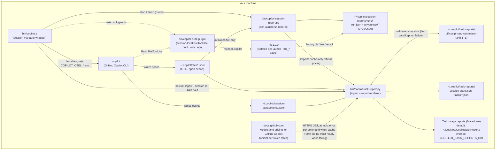
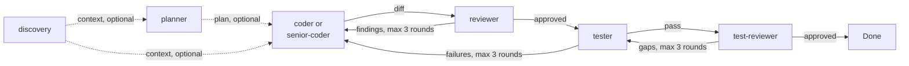

# Architecture

This document explains how the two pieces of the toolkit — the **session
manager** (`copilot-s`) and the **task usage reporter**
(`copilot-task-report.py`) — fit together, and how the **multi-agent
pipeline** (`agents/*.agent.md` + `instructions/copilot-instructions.md`)
is wired into a Copilot CLI session. It's written for someone evaluating or
extending the toolkit, not just using it.

> **History note:** prior to 2.0.0 this reporter was Jira-specific
> (`copilot-jira-report.py`, `~/.copilot/jira-reports/`, `tickets/`,
> `~/Desktop/CopilotJiraTaskReports`). See the
> [CHANGELOG's 2.0.0 entry](../CHANGELOG.md) for the rename and the
> automatic migration of existing data.

## Component overview

## 1. `copilot-s` — session manager

`copilot-s` is a Bash wrapper around the `copilot` CLI binary. It does not
replace or fork `copilot`; it manages metadata *around* invocations of it:

- **Session index** — a flat file (`~/.copilot-sessions`, format
  `session_id|name|timestamp|cwd`) tracking every known session across all
  working directories, so you can list/resume/delete sessions from anywhere.
- **New-session naming** — passes the normalized prompt response via native
  `copilot --name`, letting Copilot persist and display the title from launch.
  No post-exit ID guess is used to apply the requested title; the stop flow
  reads Copilot's resulting metadata rather than reapplying a stale prompt
  response over an in-session `/rename`. Explicit caller names and session
  selectors bypass the naming prompt. Existing wrapper index aliases retain
  their usual precedence.
- **OTEL wiring** — before launching `copilot`, it sets
  `COPILOT_OTEL_ENABLED=true`, `COPILOT_OTEL_EXPORTER_TYPE=file`, and a
  fresh per-invocation `COPILOT_OTEL_FILE_EXPORTER_PATH` under
  `~/.copilot/otel/` named `copilot-otel-<YYYYMMDD-HHMMSS>-<run-id>.jsonl`
  (the run id makes concurrent launches collision-free while keeping the
  `copilot-otel-*.jsonl` pattern every reader globs). This is what makes
  the task usage reporter possible — see below.
- **Per-launch session reports** — each launch also gets a random run id
  and a run record from `bin/copilot-session-report.py` (`start` before
  launch, `finish` after the task ingest and before the keep/rename/delete
  prompt). The record links the launch to its session only on exact
  evidence (resumed id or the strict single-new-directory detection,
  cross-checked with the hook's `session_id` and the launch's own OTEL
  conversation ids) and prices that session's chat spans from the launch's
  own OTEL file once, with the task reporter's cache-only official pricing
  functions (imported, bytecode writing disabled). `--usage-output-file`
  is added into the run's private folder unless the caller passed one.
- **RTK mode (`--rtk`)** — a per-invocation flag (never persisted).
  `copilot-session-report.py preflight` (read-only) runs before the menu;
  `start` repeats it, smoke-tests the real `rtk hook copilot` against an
  isolated preflight database, and returns the run's isolated `RTK_*`
  paths. `copilot-s` then clears every inherited `RTK_*` variable, exports
  only those paths (plus `COPILOT_S_RUN_DIR` and the pinned
  `COPILOT_S_RTK_BIN`) and adds `--plugin-dir bin/copilot-s-rtk-plugin`.
  The plugin's Claude-compatible `PreToolUse`/`Bash` hook
  (`hooks/copilot-s-rtk-hook.py`) rewrites only allowlisted plain test/build
  commands, accepts RTK's answer only if it is exactly `rtk <command>`,
  never emits a permission decision for a rewrite, denies (fail closed) when
  RTK fails, and appends a content-free decision line (with the hook's
  `session_id`) to the run folder. Any RTK-mode setup failure exits before
  `copilot` starts.
- **Automatic RTK publication (`~/.copilot/copilot-s-rtk-export/v1/runs/<run-id>.json`)**
  — one numeric-only file per RTK-mode launch (schema
  `copilot-s.rtk-launch` v1, ≤ 16 KiB, `0700` folders / `0600` files, temp
  file + `os.replace` after exact-contract validation; symlinked,
  foreign-owned or group/world-writable folders or existing files refused,
  never repaired). Three writers, all in `copilot-session-report.py`:
  (1) the launch-scoped **publisher** (`rtk-publisher`, internal): after a
  successful RTK `start`, `copilot-s` starts it in the background right
  before `copilot` with `--parent-pid $$`; it leads its own process group,
  ignores SIGINT, exits on SIGTERM/SIGHUP or when `getppid()` no longer
  equals the launcher, and every ~30 s (first after ~2 s) evaluates the
  link from the run's own hook log and per-run OTEL file (incremental
  `_EvidenceTail` readers: no-follow, descriptor-checked, ≤ 64 MiB, only
  complete lines, sticky "unusable"), runs one bounded `rtk gain --format
  json` (re-validated recorded binary, private `RTK_*` paths only, 15 s /
  1 MiB, child in the publisher's group, cancelled via a signal wake-up
  pipe) and, under the run lock with a re-read of the record, writes the
  active file unless the run is finalized. Any failure skips the write (no
  fresher `published_at` is invented). `copilot-s` stops it (SIGTERM to
  group + PID, ≤ 5 s, then SIGKILL) and reaps it (`wait`) right after
  `copilot` exits and again before `finish` and on exit, so RTK calls never
  overlap and no active result follows the final one. (2) **`finish`**
  publishes the stored final statistics (no extra RTK run) while still
  holding the run lock; failures never affect the canonical record, output
  or exit status. (3) **`start`** (any mode) runs one bounded, resumable
  reconciliation slice (`reconcile_publications`: ≤ 256 run folders probed
  by metadata in run-id order after a persisted cursor, ≤ 32 records
  loaded, ~1 s budget, non-waiting lock; RTK never run) that (re)publishes
  finalized RTK runs finalized within 14 days whose file is missing or older
  than the record/hook log (backfill never evicts and adds new files only
  below 128), withdraws files not rewritten for 14 days, files of non-publishable
  records and (default reports root only) of deleted run folders, and
  removes stale temp files. Capacity: at most 256 files; every write runs
  under `v1/.capacity.lock` (`write_publication`), and a publisher or
  `finish` write that needs a new file at the cap first evicts the oldest
  contract-valid *finalized* publications by `finalized_at`
  (`_evict_oldest_finalized`: no-follow, descriptor-checked reads, identity
  re-checked before unlinking by exact name); active publications are never
  evicted, so with all 256 active the write fails closed. Only the
  sanitized cache file is removed. Run records are read through
  `load_run_for_export` (no-follow, descriptor-checked, 8 MiB-bounded),
  never the canonical `load_run`. Session links are computed separately
  from (and never widening) the canonical `resolve_session` link: only
  `launcher-selected-resume` or `single-conversation-id-in-own-otel-file`
  (`_link_from_evidence` while active). A finalized run — whose record
  holds an OTEL status word instead of the path after `finish` — uses
  `_finalized_session_link`: the stored canonical link must be confirmed
  with exactly one of those two bases and agree with the stored evidence
  counters (`hook_session_ids`/`otel_conversation_ids` ≤ 1,
  `other_ids_ignored` = 0, clean OTEL diagnostics, clean stored hook
  summary; missing/invalid counters never read as 0) and with a fresh
  secure scan of the run's hook log; a stored `unique-new-session-dir`
  basis therefore publishes `unknown` once finalized (documented
  limitation). Directory discovery never yields a link and any conflict or
  malformed record gives `unknown`. Run records, reports, history and
  accounting are never modified. Consumers (e.g. the Agentic Watcher macOS
  app) read the files passively; publications carry no sub-agent → launch
  proof and a linked launch is not proof that a process is alive.
- **Task ID resolution** — on session start/resume/exit, it tries to
  extract a conservative `KEY-123`-style ID (`[A-Z][A-Z0-9]+-[0-9]+`) from
  the current git branch, falling back to the resumed session's stored
  branch, and finally prompting the user (with input validation and
  retry) for a brand-new session with no detectable ID — accepting either
  a `KEY-123`-style ID or a free-form task name.
- **Exit hooks** — after `copilot` exits, before the keep/rename/delete
  prompt (and before any session directory is deleted in the bulk-delete
  flow), it calls `copilot-task-report.py ingest` non-fatally: a failure
  here is reported as a warning and never blocks the keep/rename/delete
  flow.

- **Context metrics (future sessions only)** — for a brand-new session it
  can identify unambiguously (exactly one new session directory, matching
  cwd, `created_at` present, parseable and not before launch), `copilot-s` calls
  `copilot-task-report.py context-update --enroll` after `copilot` exits
  and shows the result before the keep/rename/delete prompt; on later
  resumes it refreshes only sessions that already have the sidecar
  (`<session-dir>/copilot-s-context.json`: latest valid
  `session.compaction_start` `currentTokens`/`tokenLimit` snapshot (strict
  integers, `0 ≤ currentTokens ≤ 2^53`, `1 ≤ tokenLimit ≤ 2^53`; otherwise
  counted as invalid and ignored, shown as `N/A` if none is valid) —
  "last observed before compaction", never the current usage — the count
  of `session.compaction_complete` events with `success: true`, and an
  incremental `events.jsonl` cursor with head fingerprint and
  malformed/truncated-line bookkeeping). The list calls `context-list`
  once, and only when a listed session has a sidecar; it never reads event
  logs. These commands skip task-report migrations and never touch
  reports, pricing, or ingest state. Legacy sessions are never enrolled.

- **Empty-session cleanup** — menu `c` shells out to
  `copilot-session-cleanup.py` (`preview`, then `apply` with exactly the
  previewed `id`+fingerprint pairs after a typed `yes`). The helper
  re-validates each session (only `workspace.yaml`, alone or with the
  complete, byte-for-byte verified empty Copilot scaffold —
  `.workspace-fork.lock`, empty `files/`/`research/`, header-only
  `checkpoints/index.md` — `user_named: false`, no name/summary/alias,
  ≥24h old, not open per `lsof`, unchanged fingerprint; the fingerprint of
  a workspace-only session is computed exactly as before, so existing
  batches still restore; an opt-in prompt before the preview, default No,
  passes `--include-recent` to both `preview` and `apply`, which waives only
  the 24h minimum age — future timestamps are still refused — and marks
  each candidate line so `apply` rejects a preview/apply policy mismatch,
  since the fingerprint excludes the directory's own times)
  and renames it into `~/.copilot-s-quarantine/<batch>/sessions/` with an
  atomic no-replace rename (`renameatx_np`/`renameat2`) relative to
  directories opened without following symlinks (same filesystem only),
  recording each transition — and the exact session-list rows, before they
  are removed — in the batch `manifest.json` so `restore --batch` can
  reconcile interrupted runs. Index rewrites by both scripts take an
  `flock` on `~/.copilot-sessions.lock`; a busy lock means the index is not
  modified. The cleanup holds it from the final alias re-check of each
  session through that session's row removal.
  Copilot's native session index is never touched.

- **Run-report cleanup** — menu `r` (session list and the no-sessions
  menu) shells out to `copilot-report-cleanup.py`: read-only `preview`
  (all workspaces; finalized `completed`/`copilot-error`/`interrupted`
  runs with a strictly valid, consistent record, ≥24h old unless the
  opt-in `--include-recent` marks every candidate line, plain private
  bounded trees, a matching RTK publication only, not open per a system
  `lsof` given every file and folder explicitly), then `apply` with exactly
  the previewed `run-id`+fingerprint pairs after a typed `yes`, plus
  read-only `list` and `restore --batch B [--yes]`. Apply takes the
  quarantine's `.transaction.lock`, then the producer's
  `v1/.reconcile.lock` (whole batch), each `runs/<id>/.lock` and
  `v1/.capacity.lock` (global, last) — the producer's own lock order — and
  re-validates the fingerprint under them; the open-file check exempts only
  its own verified run-lock descriptor (pid, fd, inode). It renames the
  publication, then the whole run folder (no-replace, same filesystem) into
  `~/.copilot/copilot-s-report-quarantine/<batch>/` with a durable,
  bounded `manifest.json` (`pending` → `pub_moved` → `moved`); restore
  moves the run folder back first, then the publication, and never
  overwrites. Source paths come only from the home directory and the
  validated run id. Producer writers re-read the record by its canonical
  path after taking the run lock, and reconciliation re-lists run folders
  under its lock before sweeping, so a moved run is never written to or
  republished and a restored one is not withdrawn. Nothing is deleted and
  no disk space is freed.

- **Permanent quarantine purge** — menu `x` (sessions; session list and
  the no-sessions menu) and submenu `r` → `4` (run reports) shell out to
  the helpers' `purge-list` (read-only; `PURGEABLE<TAB><batch>` lines),
  then `purge --batch B` directly on the terminal (not captured). Both
  helpers lazily load the shared stdlib engine
  `bin/copilot_quarantine_purge.py` from their own real directory (symlink
  install: the checkout; `--copy`: the prefix, where the installer copies
  it); every other subcommand works without it. Per batch the engine
  builds a read-only plan: no purge journal; the helper adapter's strict
  purge-only manifest validation (fully settled: only `moved`/`skipped`,
  ≥1 moved; sessions also require a finished session-list update and the
  configured state dir/session list; reports require consistent
  `fingerprint`/`tree_fp`/`pub_fp`/mode) and the existing fingerprint
  checks of every moved payload (`fingerprint_dir`; `scan_run_tree` +
  `read_publication`), exact top-two-level layout; a descriptor-relative,
  no-follow, bounded inventory (plain single-link files and plain folders,
  owner-only writable, no special bits/immutable flags, no repeated folder,
  same `st_dev` and same mount — macOS `fstatfs` fsid/mount-on path with an
  fsid==`st_dev` layout self-check, Linux `mnt_id` from
  `/proc/self/fdinfo` plus no `/proc/self/mountinfo` mount point at or
  under the batch); a system-`lsof` "nothing open" result; and an identical
  second inventory. The snapshot digest covers every entry's
  identity/metadata (incl. `st_blocks`, mtime/ctime, flags) and the verified
  manifest summary. `purge` prints the plan, reads the exact phrase
  `PURGE <kind> <batch> <12-hex snapshot>` from `/dev/tty` (input flushed,
  120 s, no bypass), then — under the session-list `flock` (sessions; now
  also held by `restore` while moving) or the quarantine
  `.transaction.lock` (reports; held by `apply`/`restore` throughout; the
  reconcile/run/capacity locks only guard canonical paths the purge never
  opens) — rebuilds the plan and requires the same digest. It then links a
  journal `<quarantine>/.purge/<batch>.json` (`started`, no-replace),
  deletes bottom-up via `unlinkat`/`rmdir` relative to parent descriptors
  after re-checking each entry's snapshot metadata and the binding of every
  parent from the batch down (payload, then manifest, then the batch
  folder), and records `complete` or `partial`. Any journal blocks
  `restore`, `purge` and `purge-preview` for that batch (no automatic
  retry/resume); `list` shows it additively.

`copilot-s` is intentionally the *only* place that knows about git branches,
terminal prompts, and the session index; it treats the reporter as an
external, swappable helper it shells out to.

## 2. `copilot-task-report.py` — usage aggregator

A stdlib-only Python script, invoked by `copilot-s` (or standalone via
`--report`/`--task`). It has three responsibilities: **ingest** new
telemetry, **merge** it into a per-task aggregate, and **render** that
aggregate as Markdown.

### Data sources

| Source | What it provides | Why it's needed |
|---|---|---|
| OTEL span files (`~/.copilot/otel/copilot-otel-*.jsonl`) | Per-call model, token counts (prompt/completion/reasoning/cache-read), call duration, and (when present) the per-call reasoning-effort level | This is the **primary** source — the real conversation model calls. `events.jsonl`'s own model-call events only cover small internal utility calls, not the primary chat turns. |
| `events.jsonl` (per session, under `~/.copilot/session-state/<id>/`) | Configured reasoning-effort timeline (`session.start`/`resume`/`model_change`), cumulative Copilot-internal usage checkpoints (`session.usage_checkpoint`), and subagent start/complete pairs | **Secondary** source, ingested independently of OTEL — a missing/late-arriving file on either side never blocks the other. |
| Official GitHub pricing ([article body API](https://docs.github.com/api/article/body?pathname=/en/copilot/reference/copilot-billing/models-and-pricing), cached as `~/.copilot/task-reports/official-pricing-cache.json`) | Official USD per 1M tokens per model: input, cached input, cache write (rate / "Not applicable" / column absent), output, and Default vs Long-context tiers with their input-token threshold | Turns each call's tokens into an estimated USD cost at ingestion. The explicitly recognized Image generation models table (separate text/image input and image output columns) is excluded; image generation remains unsupported and unpriced. Otherwise strictly parsed (any unsupported table schema, price cell, tier or threshold rejects the whole refresh); snapshot stores fetch time, source URL and content SHA-256 (no effective date is published). |
| `config/model-pricing.json`, `config/request-pricing.json` (installed only if absent) | Legacy approximate per-token table and company fixed per-request policy | **Inactive** — no longer read by the default report. User copies are preserved untouched; the fixed-charge helpers remain in the code, dormant. |

### Ingest semantics (why it's safe to run repeatedly)

- **Byte-offset tracking per file** — each OTEL file and each session's
  `events.jsonl` has its own tracked read offset in
  `~/.copilot/task-reports/session-state.json`. Re-running ingest with no
  new bytes is a no-op; re-running with new bytes only processes the new
  bytes.
- **Install-epoch gating** — usage is only ever counted from the moment the
  toolkit was first used on a machine (an install marker timestamp). A
  session resumed after install has its very first ingest seeded to skip
  straight past its pre-install bytes, with OTEL spans additionally checked
  directly against the install epoch as a backstop.
- **Checkpoint deltas, not cumulative totals** — Copilot's own
  `session.usage_checkpoint` events report *cumulative* usage; the reporter
  tracks the last-seen cumulative value and only books the forward delta,
  so re-ingesting never double-counts and a resumed pre-install session's
  first post-install checkpoint doesn't book its entire lifetime total.
- **Timestamped effort timeline** — a mid-session change to the configured
  reasoning effort only relabels calls that happened *after* the change,
  never calls that already happened before it.
- **Joint model × effort aggregation** — alongside the separate `by_model`
  and `by_effort` tables, each task stores `by_model_effort`
  (`{model: {effort_key: aggregate}}`), originally for the (now dormant,
  no longer rendered) per-(model, effort) fixed request charge; it is still
  recorded so existing data stays consistent. Task files persisted before this field
  existed get it started empty (with a `by_model_effort_since` timestamp);
  their earlier requests are reported as explicitly *unattributed*, never
  backfilled by guessing a split from the two marginal tables.
- **Official pricing refresh** — `ingest` and `report` call
  `refresh_official_pricing_if_due()` once (memoized per process) *before*
  taking the ingest lock, under its own `.official-pricing.lock`. It fetches
  only if the cache is missing/invalid/older than 24h, with a 1 MB cap and
  a 10s timeout per socket operation; the 20s total deadline is checked only
  between body reads. These limits are best effort, not a hard deadline: the
  socket timeout applies per operation (each receive), so a server streaming
  headers or body slowly, slow DNS resolution, or a pricing-lock wait can
  push an attempt past the nominal timeout, with no fixed upper bound. Only a
  Python `ssl.SSLCertVerificationError` (raw or as `URLError.reason`) makes
  the default fetcher retry once via the system `curl` (`-q` first so
  `~/.curlrc` is ignored, `--fail`, `--proto =https`, no `-L`, verification
  on, `--max-time 20`, `--max-filesize` plus a bounded chunked stdout read,
  fixed argv without a shell, fixed URL only; HTTP 200 and the unchanged
  effective URL are required via a `--write-out` trailer) and notes it on
  stderr; all other errors take the normal failure path. Injectable
  `PRICING_FETCHER`; `COPILOT_TASK_REPORT_PRICING_FETCH=0` disables the
  network. A failure (network/`OSError`, protocol, parse or validation
  error — handled by explicit exception types, not a blanket catch) writes
  `official-pricing-refresh-state.json`, warns on stderr, keeps the last
  valid cache, and suppresses retries for 1h, so a failing source is
  retried at most hourly. A cached snapshot is used for pricing only while
  it is at most 7 days past its fetch time (`fetched_epoch`/`fetched_at`:
  download time, not a rate effective date); older (or future-dated) it is
  kept for reference and new calls are recorded unpriced with a fixed
  reason. Cache validation covers every field used later (ids, URLs, unit,
  `snapshot_id` == `sha256:` + first 16 hex of `content_sha256`,
  `fetched_at` consistent with `fetched_epoch`, string display names /
  providers, `notes` as a list of strings, optional `category` /
  `release_status` labels as bounded non-empty strings, `lookup` equal to the one
  derived from the models); an invalid cache is rejected whole and
  re-fetched. A corrupted refresh-state file (bad UTF-8/JSON, non-numeric
  or negative/non-finite epochs/counters) is reset with a warning and shown
  in the report. Rendering, imports,
  `ensure-marker` and `normalize-task-id` never fetch.
- **Per-call official cost, recorded once** — `build_delta` prices each
  OTEL call with the snapshot in effect for that command (tier from the
  call's own input tokens; cache-read/cache-write as verified subsets of
  input; reasoning inside output, priced once; every Gemini/Google-provider
  call with reasoning tokens is conservatively unpriced because its output
  may exclude reasoning) and `merge_delta_into_task`
  adds the result to `task["official_cost"]`: per model, additive buckets
  keyed by snapshot id (calls, USD and its input/cached/cache-write/output
  components, tier counts) plus unpriced-call counts keyed by reason, and
  each snapshot's metadata once. Refreshes never reprice recorded buckets.
  Calls that predate `official_cost` on a task are rendered as *legacy*
  (`call_count` minus recorded priced/unpriced calls) — never backfilled.
- **Atomic, lock-protected writes** — the whole ingest cycle is wrapped in
  a best-effort cross-process file lock (`fcntl.flock`, falling back to
  unlocked operation if unavailable), and every file write goes through a
  temp-file-then-`os.replace` atomic write. Offsets/cursors are persisted
  *before* the task JSON, so a crash mid-ingest can only undercount on
  the next run, never double-count.
- **Truncation handling** — if a tracked file has shrunk since the last
  recorded offset (e.g. rotated/rewound), ingestion prints a warning and
  resumes from the file's current end rather than stalling forever or
  risking a double-count reread.
- **Attribution (versioned, additive)** — `merge_delta_into_task` starts a
  `task["attribution"]` block (`schema_version` 2) the first time a task is
  ingested by this version, freezing the task's existing totals as
  `legacy`. The only supported join is explicit OTEL trace context: a
  `chat` span's own `parentSpanId` (same `traceId`) naming an
  `invoke_agent` span read in the same ingest batch. That parent's
  `gen_ai.agent.name` / `github.copilot.agent.type` key the call into
  `attributed[<agent>]` (OTEL usage, per-model call counts, invocation-span
  count, and the sum of per-call official USD estimates recorded at
  ingestion — never repriced). An unnamed parent with no parent of its own
  is the session's top-level agent loop; an unnamed nested one is kept
  separate. Every other call goes to `unknown`, keyed by why the join
  failed: no `traceId`/`parentSpanId` on the span, parent span not in the
  same batch (e.g. ingest while the agent turn was still running — parent
  spans are exported after their children), or a direct parent that is not
  an `invoke_agent` span (ancestors are not walked). Unknown calls are never
  re-linked later, and calls are never attributed from timestamps, models,
  session membership, or agent intervals. `legacy + unknown + attributed ==
  totals` is checked at render time, and the report adds coverage
  percentages and per-reason data-quality diagnostics. A valid v1 block
  (which had no `attributed` bucket) is upgraded in place by adding an empty
  one; its v1 unknown rows are kept verbatim and labeled as pre-join
  history. An unsupported/malformed block is left unchanged and shown as
  unreadable. Per-agent USD is spend, not an effectiveness metric, and
  review records are never used to infer rework or causality.
- **Observed invocation registry** — `subagent.started`/`subagent.completed`
  events that carry an `agentId` are stored under
  `attribution.observed_invocations[<session id>][<agentId>]` (agent name,
  started/completed flags and timestamps, model, conflicting-observation
  count). Merging is idempotent per event kind (identical replays are
  no-ops; a differing value keeps the first and counts a conflict), the
  session-id key prevents cross-session collisions, and registry-only
  deltas (e.g. a lone `subagent.started`) are merged even without model
  calls. Registry presence is informational, not ownership, and it is not
  joined to the OTEL attribution above (no shared identifier is used); the
  self-reported `by_agent` table is unchanged. The existing cursor,
  partial-line, truncation and install-epoch semantics apply unchanged,
  including the undercount-not-double-count crash behavior (not
  exactly-once).
- **Review records** — `record-review --input <file>` validates one
  orchestrator-supplied reviewer/test-reviewer round record
  (`copilot-task-report.review-record` v1; strict fields, no defaults,
  duplicate JSON keys and NaN rejected, 64 KB cap), then under the ingest
  lock reads the task file strictly (an unreadable file is never
  overwritten), applies the bounded policy per `(task, cycle_id, stage)`
  — one record per round slot (so no second broad review), round N needs
  N−1, rounds ≤ 3, nothing after `escalated`, session changes never reset
  the budget. `approved` is not terminal: a later in-order focused round of
  the same cycle may check tests/fixes changed after the approval, and the
  report's stage outcome is the latest recorded round (a later
  non-approved round supersedes the approval and is not complete). It
  atomically writes `task["reviews"]`. An
  identical replay is a no-op; a conflicting one fails. A missing task file
  gets only `task_id` and `reviews`. It never ingests, fetches pricing,
  regenerates the report, or changes usage/attribution data; the report's
  *Recorded Reviews* section checks invocation ids against the registry by
  exact id at render time. `ingest` uses the same strict read before it
  reads any telemetry or writes session state: an existing task file that is
  unreadable, not a JSON object, or names another task (by `task_id`, else
  legacy `jira_key`, exact or normalized) makes it exit non-zero with a
  stderr message, leaving the task file, state file and offsets untouched
  (a missing file is still a new task).
- **Feature usage ledger** — additive `task["feature_usage"]` (schema v1),
  started by the first ingest after upgrade. Before that ingest's delta is
  merged, the task's totals and recorded official-cost coverage are frozen
  as `baseline` (historical, unsplittable; never rescanned or backfilled).
  `scan_otel_files` now also keeps each chat span's own `spanId` and start
  time and each session `invoke_agent` span's ids; `build_official_cost_delta`
  keeps the per-call result it already computed (snapshot, tier, component
  USD, or the unpriced reason). `build_feature_ledger_delta` turns each call
  with a valid key (session id + `traceId` + own `spanId`; ids validated
  against a bounded charset, all-zero ids rejected) and strictly valid usage
  (finite non-negative integers; booleans/strings rejected) into one
  immutable entry with that frozen price; anything else is counted per
  reason in `unledgered` (no key is invented). The same strict check now
  gates official pricing of newly ingested calls: a present but invalid raw
  count is unpriced (`UNPRICED_INVALID_USAGE`) while the token aggregates
  keep their lenient conversion (unconvertible values count as 0). A key already in the ledger
  is never re-added: the observation is counted in `repeated_observations`
  (and as conflicting if its data differs) — the byte-offset aggregation
  and its idempotence are unchanged, so those observations stay in the
  totals. `baseline + ledger + unledgered + repeated == totals` (calls,
  tokens, priced USD) is checked at render time. The existing attribution
  rule is unchanged; the ledger only copies an agent label it resolved. A
  malformed block is left untouched (new calls are then not ledgered).
- **Delivery records and feature links** — `record-delivery` and
  `record-feature-usage` follow the `record-review` pattern (strict
  versioned input, duplicate keys/unknown fields/non-finite values rejected,
  ingest lock, strict task read, atomic replace, identical replay = no-op,
  conflicting payload under an existing `record_id` refused, nothing
  ingested/fetched/rendered), except that both require an existing task
  file created by ingest and never create one. `task["delivery"]` holds lifecycle events per
  `(feature_id, cycle_id)` — one `started`, at most one terminal
  `completed`/`cancelled` not before the start, one feature per cycle — and
  confirmed material findings with a task-unique `finding_id` (regressions
  require a previous-working evidence reference). Links in
  `feature_usage.assignments` are append-only: selectors (exact call keys or
  a direct invocation, which expands only to ledger calls whose own
  `parentSpanId` is the observed `invoke_agent` span, same session and
  trace) are expanded, compared against the previewed count and sha256,
  checked against a started cycle and existing links (another cycle →
  refused; same cycle → counted once), and stored with the expanded keys.
  `feature-calls` is the read-only inspector/previewer (no lock,
  directories, migrations, pricing or network). The report's *Feature
  Delivery* section appears only when delivery records or links exist and
  renders untrusted ids/references as inline code (references refuse
  backticks, pipes and backslashes), so no HTML, link or table injection
  renders.

### Effort intent labeling

Every model call is labeled with an effort intent and its source, in
priority order:

1. `measured:<level>` — the real per-call reasoning-effort attribute on
   that exact OTEL span.
2. `configured:<level>` — the session-level configured effort in force at
   the call's own timestamp (from the timestamped timeline above).
3. `inferred:<level>` — a static agent-role → effort guess, used only when
   a call falls inside a fully-*closed* custom-agent interval (both
   `subagent.started` and `subagent.completed` observed) and no configured
   value applies. An open/in-progress agent interval is never used for
   attribution.
4. `unknown` — no information available.

### Reports

`task_path()`/`report_path()` map a normalized task ID (or the literal
`UNASSIGNED`) to a JSON aggregate (`~/.copilot/task-reports/tasks/<ID>.json`)
and a rendered Markdown report. The reports directory defaults to
`~/Desktop/CopilotTaskReports` and can be overridden with the
`COPILOT_TASK_REPORTS_DIR` environment variable. Deleting Copilot sessions
never touches these files — they live independently of session storage.

## 3. Multi-agent pipeline

`instructions/copilot-instructions.md` is the orchestrator: loaded
automatically in every Copilot CLI session, it defines task tiers
(trivial/small/standard/complex/high-risk) and a stage-selection matrix
that picks which of the 7 roles run for a given task. Code review is
mandatory for every source/code modification batch: production source,
tests (including tester-authored tests), scripts, Storybook stories, and
executable or behavior-affecting configuration, even when no executable
behavior is added. Pure prose/docs and mechanical git-only operations
are normally exempt. Other stages remain
conditional, and skips are briefly disclosed to the user. Before substantive
work on standard/complex/high-risk tasks, or any broad discovery/design
planning at any tier, the instructions require explicit approval of the
proposed route: the stages and configured routing values, all skipped
groups and reasons, and choices to approve delegation, choose main-session
handling, or specify a custom route. Only minimal classification reads are
allowed beforehand. Cancellation or decline stops work. Routing approval
does not authorize implementation, plan-mode execution, tests, or commits;
significant route changes require renewed approval. For every blocking
`ask_user` call, the first visible line of the same assistant response,
immediately before the tool call, starts with
`🛑 **NEEDS YOUR APPROVAL**`; a blocking non-approval question uses
`🛑 **NEEDS YOUR INPUT**`. The visible preamble and tool prompt are
separate; the label cannot appear only in the tool form, an earlier turn,
or hidden commentary. If `ask_user` is unavailable, use the same label in
a plain-text pause request and wait for a reply if supported. This is an
orchestrator instruction, not deterministic CLI enforcement. Small/casual
implementation retains its automatic coder route, followed by review for
code changes; simple questions remain direct. There is no
`fixer` role: `coder`/`senior-coder` apply their own targeted fixes,
always at the same tier that did the original implementation, so a
review or test failure never restarts work from scratch at a different
tier. Findings return to the original implementer (`coder`,
`senior-coder`, or the main session when it authored the change), while
the main session must not review its own changes. Tester-authored test
defects return to `tester`; production-code defects return to the
original production-code author. A tester adding/editing tests after the
broad review triggers bounded focused verification of those newly changed
tests alongside prior findings and regressions, within the same four-call
total — not a redundant broad review or budget reset. If the budget is
exhausted with code unchecked, work stops for escalation. The
`test-reviewer` remains a test-coverage/quality gate and does not replace
correctness review of tester-authored code.

The bounded flow is: `discovery` (read-only, broad/unfamiliar context
only; `gpt-6-luna`, low effort, long context) and `planner`
(ambiguity/design only, consumes discovery's output
instead of re-exploring) feed `coder` (routine CRUD/UI/standard logic;
writes and fixes production code only) or `senior-coder` (multi-file
architecture, async state, schema/data-model changes, deep structural
bugs, new services; writes and fixes production code only). `reviewer`
uses Sonnet 5.5 high/long-context by default for routine code changes and
Opus 5.5 high/long-context for senior-coder-authored, complex/high-risk,
or unknown-implementation-model changes. It does one comprehensive pass,
then at most 3 focused verification rounds checking prior findings,
regressions, and any newly changed tester-authored code, all within the
same four-invocation total — never a second broad review or budget reset —
before escalating to the user. `tester` only runs when behavior
merits testing, in a test/fix loop capped at 3 rounds before escalating;
it writes and runs tests only and never fixes production code itself.
`test-reviewer` only engages for complex/high-risk tasks, with the same
bounded one-pass-plus-3-rounds discipline as `reviewer`. Each
`agents/*.agent.md` file is a self-contained role definition (frontmatter
with `name`/`description`/`model`/`tools`, plus a prompt body) loaded by
the Copilot CLI's custom-agent mechanism; every frontmatter description
and body explicitly reinforces bounded scope, concise output, and no
duplicated work, since that's part of this pipeline's cost-control
design, not just documentation.

The default handoff order is implement → relevant tests (`tester` only when
new tests are needed; otherwise the built-in `task` route runs existing
ones) → one comprehensive `reviewer` pass over the full code-and-test batch
→ `test-reviewer` for complex/high-risk work, exchanging a compact handoff
manifest rather than per-file narration. Tests added after a coverage
review are re-run and focused-checked inside the same budgets of the same
work-item cycle (one `cycle_id` per requested work item, not the lifetime of
a task report). The
main session records each review round with `record-review` (see above);
reviewers stay read-only, and `cycle_id` scopes a budget to one requested
work item.

Cost discipline is part of the orchestration contract: the main session
handles small questions, single continuous investigations and genuinely
trivial edits itself (main-authored code edits are still reviewed
independently) and delegates only substantial context or demonstrable net
savings; implementers receive one complete bounded batch; parallel stages
are limited to independent reads/non-overlapping writes; only significant
correctness/security/safety/data-integrity/regression findings consume fix
rounds. An exhausted budget produces one actionable escalation with
explicit choices and then waits — no extra round, automatic new cycle,
budget reset or reminder loop without the user's explicit authorization.
Delivery is measured by completion, cost, elapsed time and confirmed
material defects/regressions (recorded with `record-delivery` and
`record-feature-usage` for meaningful multi-agent features only), never by
agent count or self-reported quality. `config/agent-routing.yaml`
mirrors these rules under `task_routing.orchestration_policy`; no
model/effort/context value changed.

This is pure configuration — no code ties the pipeline to the session
manager or the task reporter. You can adopt just the agents, just the
session manager, or both.

## 4. `copilot-model-refresh.py` — subagent model refresh (menu `p`)

An optional, user-triggered helper that reviews the pipeline's routes
against current official prices and official model capability docs. It never edits the shipped defaults
(`config/agent-routing.yaml`, `agents/*.agent.md`, the instructions); it
layers confirmed local overrides on top of them.

- **Inputs.** Shipped defaults (parsed from `agent-routing.yaml` with a
  strict minimal YAML-subset parser) for ten routes: the seven agents,
  `coder.small_casual`, `reviewer.stronger`, and the built-in `task`. The
  curated catalog `config/model-role-catalog.json` (installed as
  `~/.copilot/model-role-catalog.json`): official Category, Task area,
  1M-context / configurable-reasoning support and Copilot CLI client
  listing per model, with source URLs, `reviewed_on`, and `expires_on`. The
  user's `model-refresh/user-config.json` (availability list with
  `verified_on`, pins, optional dated local catalog overlay; never written
  by the tool) and `model-refresh/verified-models.json` (written only by
  the interactive `record-verified` after an exact `yes`: the model IDs and
  per-model reasoning levels the user saw in `/model`, whether the list is
  complete, dated; a level carried over keeps its original date). Native
  `settings.json` `subagents.agents.<agent>` values. Official pricing comes
  from `copilot-task-report.py`, loaded via `importlib`:
  `refresh_official_pricing_now()` reuses the fixed-URL fetcher, parser,
  validation, lock, cache, and keep-last-valid behavior, skipping only the
  24h TTL and 1h failure backoff (a snapshot under 5 min old is reused).
  The parser additionally records each model's official `category` and
  `release_status` labels when present and consistent (optional, validated
  snapshot fields; never used for pricing).
- **Live capability evidence.** In the same run (not for `status`, `select`
  or `apply`, which are cache-only) the helper fetches two fixed
  docs.github.com article-body URLs — `supported-models` (sections
  "Supported AI models in Copilot", "Models with extended capabilities",
  "Supported AI models per client") and `model-comparison` ("Recommended
  models by task") — with its own bounded stdlib HTTPS GET (certificate
  verification on, every redirect refused, 10 s per operation / 20 s total,
  2 MB cap; after a Python certificate-verification failure only, the
  system curl with `-q`, `--proto =https`, no `-L`, verification on). A
  strict, versioned Markdown table parser maps the octicon `aria-label`s
  (Supported / Not supported / Included / Not included) and text cells to
  fields, derives model IDs with the pricing parser's own mechanical name
  rule, and makes a whole section UNKNOWN on a missing/duplicated heading,
  missing column or malformed row; duplicate rows that disagree make that
  model's field unknown. Text is sanitized to a small character allowlist
  and never reaches generated instructions. The snapshot
  (`model-refresh/capability-evidence.json`: URL, fetch time, content
  SHA-256, parser version, parsed sections) is reused for 5 min, is usable
  for 3 days (supported-models) / 7 days (model-comparison), and a failed
  fetch keeps the last valid copy (shown with its age; stale copies
  authorize nothing). Fetching is skipped with
  `COPILOT_MODEL_REFRESH_DOCS_FETCH=0`, `COPILOT_TASK_REPORT_PRICING_FETCH=0`
  or `--offline`, and whenever a test injects a pricing transport without a
  capability transport.
- **Third-party comparisons (`bin/copilot_model_benchmarks.py`).** A
  library next to the helper (installed alongside it; missing/broken =
  "unavailable", official flow unchanged) holding a reviewed registry:
  providers (fixed host, page layout id, metric allowlist, stated limits)
  and exact pair pages (URL, canonical page, Copilot model ID ↔ display
  name). On `propose`/`preview` (never `status`, `select`, `review`,
  `apply` or `details`) every page not fetched in the last 5 min is GET
  automatically: host resolved once, every address must be public
  (`ipaddress.is_global` and not private/loopback/link-local/reserved/
  multicast), connection pinned to it with SNI and certificate
  verification (system curl `--resolve` pin only after a Python
  certificate error), redirects refused, HTTP 200 + `text/markdown`/
  `text/plain` only, 8 s timeout, 20 s shared deadline, 1 MB cap, no
  cookies/auth/query. Per-layout parsers (BenchLeader `.md` alternate:
  front-matter `url`, title, "Updated" date, "Every benchmark" table with
  per-column effort and `†` = other effort; BenchLM markdown: title,
  canonical page, "Last updated", Category Breakdown tables and
  public-lane scores, "Estimated" flagged) verify identity and extract only
  allowlisted metrics (0–100, expected unit); duplicates/unknowns become
  unknown; no remote free text is stored. Cache
  `model-refresh/benchmark-evidence.json` (0600; registry digest + parser
  version, per page URL, fetch time, page date, SHA-256, layout, efforts,
  metrics, notes; strict validation, any mismatch ignores the whole file),
  fresh for 24 h; stale copies are reference only. `comparison(current,
  candidate, current_effort, candidate_effort)` returns per-source metrics
  for the directed pair, marks each comparable only when both values exist
  at the stated setting and are not duplicated/estimated, sets an entry's
  `setup_matches` only when the page states BOTH models' effort and it
  equals the route's levels, and reports `supports` (a comparable metric
  higher for the candidate in a FRESH copy whose setup matches), `mixed`
  and `providers_disagree` disclosures — never an average, winner, price
  or cross-source blend. Parsing is linear: headings are recognised with
  string operations (no backtracking pattern), lines over 20,000
  characters are skipped, cells are cut to 1,000 characters before link
  stripping, and the remaining patterns are anchored and bounded.
  Kill switches: `--offline`, `COPILOT_MODEL_REFRESH_BENCHMARKS_FETCH=0`,
  `COPILOT_TASK_REPORT_PRICING_FETCH=0`, or an injected pricing transport
  without `BENCHMARK_FETCHER` (tests).
- **Model facts.** Per model and field: fresh live evidence, else the dated
  catalog (shipped or local overlay) as a documented fallback, else
  unknown. A live value that differs from the shipped catalog is shown as a
  note; one that contradicts the local overlay fails closed. Absence from
  the per-client or capability table is evidence ("not listed" / "not
  documented"); absence from the comparison table is not (the catalog value
  still applies). When every gate field is live, the Category comes from
  the live pricing; when any comes from the catalog, the catalogued
  Category must still match the live pricing. The visible model universe is
  the union of pricing, live pages, catalog, the user's verified records
  and the current routes; unpriced or undocumented models stay listed as
  unknown, and availability is never claimed beyond the user's records.
- **Resolution.** shipped defaults → managed overrides (`state.json`) →
  `/subagents` values the tool did not write (agent default routes) →
  user-config pins (any route). Pinned routes are never re-proposed.
- **Policy.** `balanced` (default; menu `p`) or `cost-led` (`--cost-led`;
  `copilot-s` passes it only with `COPILOT_MODEL_REFRESH_POLICY=cost-led`).
  The policy is sealed in the proposal and part of the evidence digest.
  In balanced mode the cost-led decision below is still computed but never
  proposed (its evidence lines are dropped): every route keeps its model
  unless the user selects an option.
- **Decision.** Proposals require a pricing snapshot under 24h old and an
  unexpired catalog (or, when it has expired, fresh live evidence for every
  parsed section; per model, catalog-based facts still fail closed). A
  candidate must match the route baseline's official
  task area with an equal-or-higher Category (or a dated route override),
  support configurable reasoning and, for `long_context` routes, the 1M
  window, be listed as included for Copilot CLI, still show its catalogued
  Category in the live pricing, be in the user's availability list (≤ 30
  days old), have the route's specific reasoning level verified for that
  model (source-backed catalog `reasoning_levels` — none shipped, since the
  docs do not list levels per model — or the user's ≤ 30-day
  `verified_capabilities`; never inferred from `configurable_reasoning`),
  and be ≥ 10% cheaper on a disclosed blended mix (15% input, 75% cached,
  5% cache write, 5% output) of the Default-tier rates and, for
  `long_context` routes, of the above-threshold tier rates too. An unpriced
  current model (shipped baseline or override) is always kept, and an
  existing managed override whose evidence is unavailable or stale is kept
  with the reason, never reverted or re-selected; returning from an
  override to the shipped baseline is itself a change and must pass every
  gate — only keeping the current baseline is exempt. All entered dates are
  compared with the user's local calendar date (no tolerance). Catalog
  origins with future-dated reviews/source retrievals, sources newer than
  the review, or `expires_on` not after `reviewed_on` authorize nothing.
  Otherwise the route is
  kept with the reason; user-fixable blocks (availability, reasoning level)
  end the output with an ACTION REQUIRED block and a config example (and
  plain `propose` prints `VERIFY<TAB>needed`; `copilot-s` uses review mode
  instead, below). The
  table states that fit is categorical, not measured or equal quality.
- **Options (alternatives).** Per unpinned route with a known current
  price, an eligible model (every gate above except the 10% rule) in the
  route's accepted task area is offered with `bases`: `saving` (≥ 10%
  cheaper; balanced only — cost-led lists the non-cheapest ones as
  considered), `official` (a concrete documented differentiator versus the
  current model: official Copilot CLI "included" where the current model is
  not, the route's task area where the current model's differs, or
  documented 1M context (long_context routes) / configurable reasoning the
  current model lacks) and/or `benchmark` (only for a NOT-cheaper model: a
  fresh reviewed third-party comparison of that exact pair `supports` it at
  the route's levels); `alignment` (balanced only) is the CURRENT model at
  the route's shipped baseline effort/context when the current values
  drifted from it and that model passes every gate there (the overview
  always shows a `drift:` line for such a route, with the option number or
  why no correction can be offered). The short view shows at most three
  comparable metrics per source in turn from each direction plus counts
  of hidden ones per direction; a later option with the same DIRECTED
  pair references the earlier one but repeats its own setup note,
  disclosures and caution.
  Category, newness or price are never reasons; without one the model is
  listed as considered with that reason. Options are numbered (route
  order, then price) and rendered with the blended Default (and
  long-context) price delta in $ and %, both models' official rates, the
  reasons with sources, the third-party evidence and cautions, the
  official "Excels at" text labelled as the vendor's description, and what
  remains to confirm; `propose` prints `ALTERNATIVE<TAB>n<TAB>route<TAB>model`.
  None is ever pre-selected: when nothing else changes, `propose` still
  exits 3 but freezes a no-op proposal so an explicit selection is possible.
- **Output.** `propose`/`preview` print a change-first overview (source
  summary, every route with current values and option numbers, the
  options, third-party coverage + caution + source URLs, ACTION REQUIRED
  for plain propose, next step); `--details` appends the full report, and
  `details [--proposal-id ID]` prints it from caches only (no lock, no
  network, no writes; a proposal is peeked read-only after checking id,
  format, lifetime and seal, and the output says whether its evidence
  still matches). Colour: SGR codes only on stdout when it is a terminal
  or `COPILOT_MODEL_REFRESH_COLOR=always`, never with `NO_COLOR`/
  `TERM=dumb`, never on machine lines; widths and wrapping are computed on
  plain text (`COLUMNS` wins; a pipe without it is not wrapped), and words
  are never broken.
- **Review mode (`propose --review`, what menu `p` runs).** A candidate
  whose ONLY failing gates are availability and/or the exact reasoning
  level (user-fixable codes) is kept as tentatively eligible and may be
  proposed; every other gate, pins, the 10% rule and "never an automatic
  premium" are unchanged, and current routes stay the fallback. The
  proposal seals a `review` object (round, models you confirmed available,
  models you called unavailable, yes/no per model+level). Output adds the
  mapping table, each proposed model once (routes, needed levels, price,
  rationale, what is pending) and machine lines
  `CHECK<TAB>model<TAB>routes`, `LEVEL<TAB>model<TAB>effort`,
  `REVIEW<TAB>pending|complete` and `SELECTED<TAB>count`. `review
  --proposal-id ID (--available-all | --unavailable IDS) [--level
  MODEL:EFFORT=yes|no ...]` accepts answers ONLY for the displayed CHECK /
  LEVEL items (every CHECK model must be answered; listed IDs must be a
  subset), re-derives cache-only from the same frozen inputs (refusing on
  any digest/evidence change or expiry), applies the answers — an
  unavailable model is excluded even if an older saved record lists it; a
  "no" level excludes the model wherever that level is needed — and writes
  a new sealed proposal (new id, same expiry; selections carried only by
  identity, dropped if no longer offered). Answers are never written to
  `verified-models.json`, `user-config.json` or routing files. Each round
  answers at least one item, and rounds are capped (25 helper, 20 menu).
  `apply` refuses any proposal that still has pending items. Saved
  availability/level evidence is always reused first; `record-verified`
  remains a separate command.
- **Two-phase apply.** `propose` writes `pending-proposal.json` (format 4,
  15 min TTL; older formats are refused) with digests of settings, state,
  user config, verified record, routing defaults, catalog, capability
  evidence, third-party comparison cache (registry digest + per-page record
  hash + freshness), pricing snapshot and generated files, the expected
  output digests, an evidence digest (pricing snapshot and status,
  capability digest incl. freshness, third-party digest, policy, catalog,
  availability records, local date, each route's decision and options with
  their bases), the sealed `policy` and the numbered options. `select
  --proposal-id --choose N[,N]` re-derives everything cache-only, refuses
  on any difference, and writes a NEW proposal (same expiry) whose
  overrides add the chosen options (one per route; the choice replaces any
  earlier selection and, in cost-led mode, that route's cost-led change). `copilot-s` asks for an exact `yes`, then `apply
  --proposal-id` re-reads everything, re-derives the decisions, refuses on
  any mismatch, on an older-format proposal, on overrides that are not
  exactly the re-derived ones (tampering), and on a proposal id already in
  the state history (replay). The capability digest hashes each parsed
  record (sections, models, values, provenance) with its freshness, and the
  pricing digest hashes the parsed rates/labels, so a changed cached value
  is detected even when ids are unchanged. Each proposal carries an
  HMAC-SHA256 seal keyed by a private random `model-refresh/.proposal-key`
  (0600; created on first `propose`); `select`/`apply` refuse a broken
  seal, a creation time in the future, or an expiry other than exactly
  creation + 15 min (`select` keeps the original creation/expiry and
  re-seals). Models listed only in a stale/future-dated cached page stay in
  the model list as unknown with a note; their facts are never used. The commit writes a journal and per-file backups,
  re-checks each file's digest immediately before replacing it, defers
  SIGINT/SIGTERM/SIGHUP, and rolls back on failure; an interrupted commit is
  rolled back on the next run unless the file was changed by someone else
  (then it stops and reports). Writes: `settings.json` (managed fields only
  — the effective value of a managed override with user-config pins on top —
  never a human `/subagents` value, never through a symlink), the generated
  `instructions/copilot-toolkit-model-routing.instructions.md` (only while
  a managed override or a user-config pin exists; never through a symlink
  or over a file it did not write), `effective-routing.json`, and
  `state.json`. Native `/subagents` pins are never copied into either
  generated file: their fields are written as "omit" (`null` in
  `effective-routing.json`) so later `/subagents` edits stay live.
- **Runtime effect.** The shipped instructions tell the orchestrator to run
  `copilot-model-refresh.py status --instructions` (local, read-only, no
  network, no pricing/catalog needed) before each delegation to a toolkit
  route and pass the printed `model` / `reasoning_effort` /
  `context_tier`; a field printed as `OMIT` (any field currently set by a
  human in `/subagents`, read live from `settings.json`) is left out of the
  task call — the task tool has no `inherit` value. If the helper is
  unavailable or reports the routing unavailable, the generated table
  (same omit rule) or else the shipped defaults apply. Copilot CLI does not
  document the precedence between `subagents.agents` settings and explicit
  task-tool parameters; omitting a field is the only way to leave the
  native value in effect, and all of this is instruction guidance, not an
  enforced runtime guarantee.

## Known limitations

See the [README's task reporting section](../README.md#task-usage-reporting)
for the full, current list of documented tradeoffs (OTEL availability,
truncation gaps, USD estimate accuracy, etc.) — they are kept in one place
to avoid drift between this document and the README.
